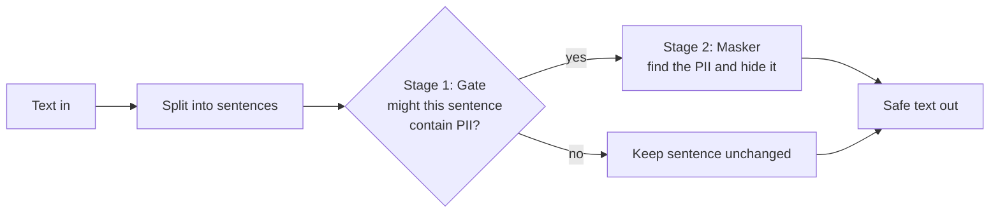
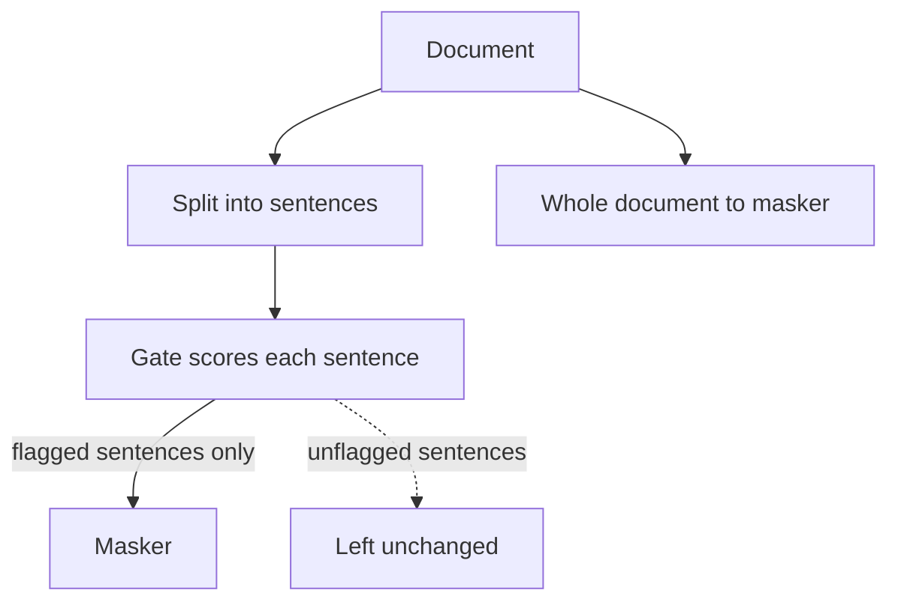

# pii-guardrail-qml

**A two-stage PII guardrail for LLMs.** Stage 1 detects sensitive information with quantum (simulated) and
classical classifiers; Stage 2 uses small language models to mask it and measures how much still leaks
under stress.

> Research name: *Clean F1 hides leaks: stress-testing small-language-model PII maskers, with a
> quantum-vs-classical benchmark for the PII gate.*

## 1. In plain words

**PII** means personal details: names, emails, phone numbers, ID numbers. When people paste text into an
AI chatbot, that text can contain such details. A **guardrail** is a filter that hides them first.

```
Text in :  Hi, I am Jane Smith. Call me on 555-0142 or write to jane@example.com.
Goal    :  Hi, I am [NAME]. Call me on [PHONE] or write to [EMAIL].
```

Real output of our trained DeBERTa masker on that exact sentence (not a hand-edited example):

```
Hi, I am Jane Smith. Call me on 555-0142 or write to [EMAIL].
```

It hid the email but **missed the name and the phone number**. Spotting this kind of miss is the point of
the project. A model can get a good score on easy text and still let details through, so besides the usual
score (**F1**) we measure the **leak rate**: *what share of the private characters are still readable after
masking.* Lower is better.

## 2. How it works



- **Stage 1, the gate**, is a quick yes/no check on each sentence. The idea is to save time by not running
  the heavier masker on sentences without PII. Here we compare ordinary classifiers with **simulated
  quantum** ones (quantum circuits run on a normal computer).
- **Stage 2, the masker**, points at the exact private words and replaces each with a label like `[EMAIL]`.
  We compare one small specialised model with two small chat-style language models.

The guardrail sits in front of whatever receives the text, so in principle it could protect any LLM. We
tested the guardrail itself; we did not connect it to a chatbot.

## 3. The models

The two stages do **different jobs**, so models are only compared within their own stage.

| Stage | Job | Models |
|---|---|---|
| 1. Gate | one sentence → "has PII? yes / no" | logistic regression, small neural net (MLP), **VQC** (quantum circuit), **quantum-kernel SVM**, and a fine-tuned MiniLM as a best-case reference |
| 2. Masker | whole text → exactly which pieces are PII | **DeBERTa-v3-small**, **Qwen2.5-0.5B + LoRA**, **SmolLM2-360M + LoRA**, and Qwen with no training (baseline) |

All gate models (except the MiniLM reference) get the **same 8 numbers per sentence**, a squeezed-down
summary of its meaning, so the quantum-vs-classical comparison is fair. Quantum models ran on a **simulator**;
no real quantum computer was used.

## 4. How we stress-test it

Besides ordinary test text, each masker is scored on harder text made from the held-out data:

| Stress set | What is harder | Example |
|---|---|---|
| Disguised email / phone / name / ID | PII written in an odd way | `jane at example dot com`, digits spelled as words, extra spaces, odd separators |
| Rare types | only the 30% of PII types seen least in training | the least common kinds of ID |
| Other languages | German, French, Italian | same job, different language |
| Context-only | 50 hand-written cases where an ID is only recognisable from the words around it | label `CONTEXT_ID`; never seen in training |

## 5. Gate and masker together

We also ran the full two-stage flow and compared several ways to use the gate:



| Mode (name in results) | What the masker sees |
|---|---|
| `masker_doc` | the whole document, no gate |
| `masker_sent` | every sentence separately, no gate |
| `gate_*` | only the sentences the gate flags |
| `docgate_*` | the whole document, but skipped entirely if **no** sentence is flagged |
| `gate_oracle`, `docgate_oracle` | same, with a perfect gate (the best any gate could do) |

**What we found:** masking sentence by sentence leaks about 15.5% of private characters against 1.2% for whole
documents, and the gate is not the cause. A gate that only decides whether to skip a whole document keeps
the 1.2% leak, but it skips almost nothing here (0% of documents for logistic regression, MLP and VQC; 9.6%
for MiniLM), because about 87% of the test documents contain PII (even a perfect gate would skip only 13.4%). So **on this data the gate saves little time.**
For real use, the safest option measured is the whole document to the masker (`document` mode below).

## 6. Results

<!-- RESULTS:START (generated by scripts/make_report.py from results/; do not edit) -->
### Key findings

Generated from `results/` by `make report` (full profile). See [`reports/report.md`](reports/report.md) for confidence intervals, paired tests, per-set tables and limitations.

- Gate: VQC (exact) ROC-AUC 0.933 vs logistic regression 0.934 (difference -0.001); VQC trains in 21.0 s vs 0.002 s.
- Gate: fine-tuned MiniLM without the PCA bottleneck reaches ROC-AUC 0.995, against 0.935 for the 8-feature logistic regression (both trained on the full training pool).
- Barren plateau: mean gradient variance falls 66x from 2 to 8 qubits.
- Low data (n=50): Logistic regression 0.922, MLP 0.816, Quantum kernel SVM 0.923, VQC 0.908 ROC-AUC.
- VQC ablation: best variant `layers5` with ROC-AUC 0.935.
- Feature sweep: logistic regression goes from ROC-AUC 0.929 at k=4 to 0.963 at k=64.
- DeBERTa-v3-small: clean entity F1 0.917, character leak 0.011; worst stress-set F1 is 0.695 on `obf_all` (leak 0.051).
- Qwen2.5-0.5B + LoRA: clean entity F1 0.847, character leak 0.107; worst stress-set F1 is 0.762 on `cross_de` (leak 0.125).
- Pipeline (clean): masker on whole documents leaks 0.0124; on sentences 0.1554.
- Pipeline (clean) docgate_logreg (whole-document masking, gate may skip a document): leak 0.0124, skips 0.0% of documents, latency p50 5.6 ms.
- Pipeline (clean) docgate_minilm_ft (whole-document masking, gate may skip a document): leak 0.0132, skips 9.6% of documents, latency p50 5.2 ms.
- Pipeline (clean) docgate_mlp (whole-document masking, gate may skip a document): leak 0.0124, skips 0.0% of documents, latency p50 5.6 ms.
- Pipeline (clean) docgate_vqc (whole-document masking, gate may skip a document): leak 0.0124, skips 0.0% of documents, latency p50 10.3 ms.
- Pipeline (clean) gate_logreg: skips 0.21 of sentences, leak 0.1620, latency p50 6.7 ms vs 3.3 ms masker-only.
- Pipeline (clean) gate_minilm_ft: skips 0.51 of sentences, leak 0.1586, latency p50 5.1 ms vs 3.3 ms masker-only.
- Pipeline (clean) gate_mlp: skips 0.18 of sentences, leak 0.1585, latency p50 6.8 ms vs 3.3 ms masker-only.
- Pipeline (clean) gate_vqc: skips 0.17 of sentences, leak 0.1577, latency p50 11.2 ms vs 3.3 ms masker-only.

### Stage 1: gate (simulated quantum vs classical, 8 shared features)

| model | accuracy | F1 | ROC-AUC | latency ms/sentence | seeds |
|---|---|---|---|---|---|
| Logistic regression | 0.871 | 0.871 | 0.934 | 0.0459 | 5 |
| MLP | 0.870 | 0.870 | 0.933 | 0.0442 | 5 |
| VQC (quantum, exact) | 0.869 | 0.872 | 0.933 | 4.34 | 5 |
| VQC (noise p=0.01) | 0.874 | 0.880 | 0.936 | 85 | 5 |
| Quantum kernel (angle) | 0.884 | 0.886 | 0.935 | 1.55 | 3 |
| Quantum kernel (IQP) | 0.816 | 0.833 | 0.905 | 5.25 | 3 |
| MiniLM fine-tuned (upper bound) | 0.978 | 0.979 | 0.995 | 1.14 | 3 |

### Stage 2: maskers (character leak = share of PII characters left unmasked)

| masker | seeds | F1 clean | F1 obfuscated | F1 rare | leak % clean | leak % obfuscated | latency p50 ms |
|---|---|---|---|---|---|---|---|
| DeBERTa-v3-small | 3 | 0.917 | 0.695 | 0.878 | 1.1 | 5.1 | 3.5 |
| Qwen2.5-0.5B + LoRA | 3 | 0.847 | 0.772 | 0.812 | 10.7 | 14.3 | 397.4 |
| SmolLM2-360M + LoRA | 3 | 0.792 | 0.735 | 0.765 | 13.2 | 21.8 | 596.0 |
| Qwen2.5-0.5B zero-shot | 1 | 0.008 | 0.009 | 0.015 | 59.7 | 61.9 | 491.7 |


### Two-stage pipeline (clean documents)

| arm | F1 | leak % | skipped by gate | latency p50 ms |
|---|---|---|---|---|
| docgate_logreg | 0.923 | 1.24 | 0.0% of documents | 5.6 |
| docgate_minilm_ft | 0.923 | 1.32 | 9.6% of documents | 5.2 |
| docgate_mlp | 0.923 | 1.24 | 0.0% of documents | 5.6 |
| docgate_oracle | 0.925 | 1.24 | 13.4% of documents | – |
| docgate_vqc | 0.923 | 1.24 | 0.0% of documents | 10.3 |
| gate_logreg | 0.788 | 16.20 | 21% of sentences | 6.7 |
| gate_minilm_ft | 0.789 | 15.86 | 51% of sentences | 5.1 |
| gate_mlp | 0.787 | 15.85 | 18% of sentences | 6.8 |
| gate_oracle | 0.797 | 15.54 | 55% of sentences | – |
| gate_vqc | 0.788 | 15.77 | 17% of sentences | 11.2 |
| masker_doc | 0.923 | 1.24 | – | 3.3 |
| masker_sent | 0.789 | 15.54 | 0% of sentences | 4.7 |

<!-- RESULTS:END -->

### Reading the results

- **Quantum timings are simulator timings**, not real-hardware numbers.
- **F1 and leak rate answer different questions.** F1 asks "were the exact pieces found?". Leak rate asks
  "how much private text is still readable?".
- **The gate is limited by its 8 input numbers.** The fine-tuned MiniLM, which reads the full sentence, is
  the best-case reference.
- **Pipeline:** the `masker_doc` vs `masker_sent` gap is the cost of cutting text into sentences, not the gate.
- Zero-shot has one seed, the trained maskers three. Confidence intervals, paired tests and the extra quantum
  experiments (low data, depth, feature count) are in [`reports/report.md`](reports/report.md).

## 7. Where everything is saved

Trained models and test data are **not in git** (too big). They live in two folders that the scripts create:

| What | Path | Size | Notes |
|---|---|---|---|
| DeBERTa masker (3 seeds) | `checkpoints/deberta_seed{0,1,2}/best/` | 548 MB each | the best one to use; seed 0 is the default |
| Qwen LoRA masker (3 seeds) | `checkpoints/qwen_lora_seed{0,1,2}/adapter/` | 34 MB each | needs the base model, downloaded from Hugging Face on first use |
| SmolLM2 LoRA masker (3 seeds) | `checkpoints/smollm_lora_seed{0,1,2}/adapter/` | 34 MB each | same |
| Gates: logistic regression, MLP, VQC, MiniLM | `checkpoints/gates/` | 87 MB | written by `scripts/run_pipeline.py` or `scripts/export_gates.py` |
| Test set (1,000 documents) | `data/processed/test.parquet` | | columns: `id, language, text, spans_json` |
| Stress sets | `data/processed/stress/*.parquet`, `cross_{de,fr,it}.parquet` | | `obf_*`, `rare`, `context_only` |
| Gate test sentences | `data/processed/gate_test_all.parquet` | | one row per sentence, with a PII label |
| Measured numbers | `results/` (summary CSVs are in git) | small | every figure above comes from here |

`checkpoints/deberta_seed*/` also hold large training snapshots; only `best/` is needed for use.

**Getting them onto another machine.** Copy the folders from the machine that trained them, for example
`scp -r <gpu-host>:~/pii-guardrail-qml/checkpoints/deberta_seed0/best checkpoints/deberta_seed0/` and the same for
`checkpoints/gates`. The test data can be rebuilt anywhere with `make data stress` (downloads about 200 MB from
Hugging Face). To share the weights publicly, upload them to Hugging Face or use Git LFS; they are not committed.
The gate file `classical.joblib` is a pickle, so only load files you made yourself.

## 8. Use it on new text (inference)

All three ways run the same code. `document` mode is the recommended one.

**a) Command line**

```bash
python scripts/infer.py --masker checkpoints/deberta_seed0/best --text "Call me on 555-0142"
python scripts/infer.py --masker checkpoints/deberta_seed0/best --file notes.txt
echo "Mail jane@example.com" | python scripts/infer.py --masker checkpoints/deberta_seed0/best --json
```

**b) From Python**

```python
from piiguard.inference import PiiGuardrail

guard = PiiGuardrail.from_dir("checkpoints/deberta_seed0/best")  # masker only
r = guard.mask("Hi, I am Jane Smith. Write to jane@example.com.")
print(r.masked)  # text with [LABELS] in place of PII
print(r.spans)  # [{"start", "end", "label", "value"}, ...]

# with a gate (needed for the doc_gate and sentence modes)
guard = PiiGuardrail.from_dir("checkpoints/deberta_seed0/best", "checkpoints/gates", gate="logreg")
guard.mask(text, mode="doc_gate")
```

**c) Real-time web service** (standard library only, nothing extra to install)

```bash
python scripts/serve.py --masker checkpoints/deberta_seed0/best --port 8000
curl -s localhost:8000/health
curl -s localhost:8000/mask -d '{"text": "Call me on 555-0142 or mail jane@example.com"}'
# -> {"masked": "...", "spans": [...], "mode": "document", "masker_ran": true}
```

The service listens on `127.0.0.1` only and has **no login**. Text sent to it is personal data, so put
authentication and HTTPS in front before exposing it to a network.

**Modes** (`mode=` in Python and JSON, `--mode` on the command line):

| Mode | What it does | Measured leak (clean text) | Needs gate |
|---|---|---|---|
| `document` (default) | masker reads the whole text | 1.2% | no |
| `doc_gate` | like `document`, but skips the masker if no sentence is flagged | 1.2% | yes |
| `sentence` | masker only sees flagged sentences | 15.5 to 16.2% | yes |

**Choosing the masker:** DeBERTa is the fastest (about 3 to 5 ms per document on a GPU) and leaked least on
clean text. Qwen + LoRA is about 400 ms per document and was more robust on some disguised text (see the
table above). Pass the LoRA adapter folder instead of the DeBERTa folder to use it:
`--masker checkpoints/qwen_lora_seed0/adapter`.

Texts longer than DeBERTa's 512-token limit are split into sentence groups automatically, so the tail of a long
text is never silently left unmasked.

**Check a saved model on the test sets** without retraining:

```bash
python scripts/eval_checkpoint.py --masker checkpoints/deberta_seed0/best --sets clean obf_email --n 100
```

Smoke check on the saved seed-0 DeBERTa (100 documents each): clean F1 0.911, leak 2.74%; disguised email
F1 0.715, leak 10.58%.

## 9. Rebuild everything

```bash
make setup      # install (uses uv)
make test       # unit tests, offline
make lint
make smoke      # tiny version of every stage
make reproduce  # full runs; needs a CUDA GPU (a few hours in total)
```

Single stages: `make data stress gate masker pipeline eval report`. The extra quantum experiments:
`python scripts/run_quantum_extras.py --config configs/full.yaml`. The device is picked automatically
(`cuda`, then `mps`, then `cpu`). Settings are in `configs/smoke.yaml` and `configs/full.yaml`.
Optional demo UI (`pip install gradio`): `python demo/app.py --config configs/full.yaml`.

**Honesty rule:** every number here and in `reports/` comes from files in `results/`; `make report` regenerates
them. Nothing is typed by hand (the two sample outputs in sections 1 and 8 are real command output).

## 10. Project layout

```
configs/                 smoke.yaml (quick) and full.yaml (real runs)
scripts/                 prepare_data, run_stress, run_gate, run_masker, run_pipeline, run_eval,
                         run_quantum_extras, make_report   (experiments)
                         infer, serve, export_gates, eval_checkpoint   (using saved models)
src/piiguard/data/       loading, labels, sentences, stress sets, training pairs
src/piiguard/gate/       classical models, VQC, quantum kernel, MiniLM, metrics
src/piiguard/masker/     DeBERTa, LoRA fine-tuning, LLM inference, span parsing
src/piiguard/pipeline/   gates (fit, save, load), assembling the two stages
src/piiguard/inference.py  PiiGuardrail: the class to call on new text
src/piiguard/serve.py      the small HTTP service
results/                 run records and summary tables      reports/   report.md and figures
```

The original task description is in [`PROJECT_BRIEF.md`](PROJECT_BRIEF.md).

## 11. Limitations

- Quantum results are **simulated**; real hardware was not used.
- The dataset (`ai4privacy/pii-masking-300k`) is **synthetic**; results may not transfer to real text.
- The gate sees only **8 numbers per sentence**, which caps every gate model except the MiniLM reference.
- Language-model maskers return PII as text and we find it again by **exact string matching**, which can
  over-mask repeated words and miss altered strings.
- Masking **sentence by sentence** leaks far more than whole documents; the gate saves little time on this data.
- The 50 context-only examples are hand-written and not independently reviewed.
- The guardrail was **not tested with a downstream LLM**, and the HTTP service has no authentication.

## 12. Dataset license

Data comes from [`ai4privacy/pii-masking-300k`](https://huggingface.co/datasets/ai4privacy/pii-masking-300k),
which has its own license and terms. Check the dataset card before redistributing derived data.
Processed data is git-ignored here.
