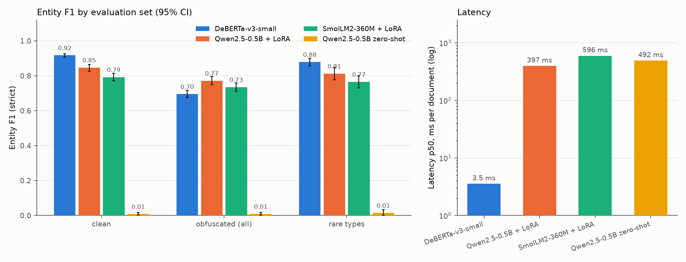

# pii-guardrail-qml

**Clean F1 hides leaks: stress-testing small-language-model PII maskers, with a quantum-vs-classical benchmark for the PII gate.**

A two-stage PII guardrail for LLM pipelines:

```
text ─► Stage 1 GATE (contains PII?) ─► Stage 2 MASKER (find + redact spans) ─► safe text
         classical vs quantum              encoder vs small instruction LLMs
```

The full task description is in [`PROJECT_BRIEF.md`](PROJECT_BRIEF.md). The results are in
[`reports/report.md`](reports/report.md), generated from files in `results/`.

**Honesty rule:** every number in `reports/` and in the results section below comes from files in
`results/`; `make report` regenerates both. Nothing is typed by hand.

## What is measured

| Part | Question | Models |
|---|---|---|
| Stage 1 gate | Does a quantum classifier beat classical ones on identical 8-feature inputs? | logistic regression, MLP, VQC (exact / shots / depolarizing noise), quantum-kernel SVM (angle, IQP), fine-tuned MiniLM as an upper bound |
| Extra quantum scenarios | Low-data learning curves, VQC depth and data re-uploading, number of features / qubits | same features, exact simulation |
| Stage 2 masker | How much PII leaks under stress, and does clean F1 predict it? | DeBERTa-v3-small token classifier; Qwen2.5-0.5B and SmolLM2-360M with LoRA (JSON output); Qwen zero-shot |
| Stress sets | Obfuscated emails / phones / names / IDs, rare PII types, German / French / Italian, context-only identifiers | built from the held-out test split |
| Pipeline | Does the gate save masker work, and what does it cost in leaks and latency? | each gate in front of DeBERTa, plus masker-only baselines and an oracle gate |
| Statistics | Are differences real? | 95% bootstrap CIs over documents, paired bootstrap tests, Holm correction |

Headline privacy metric: **character leak rate**, the share of gold PII characters not covered by any
predicted mask (type ignored). Strict entity F1 is reported next to it.

<!-- RESULTS:START (generated by scripts/make_report.py from results/; do not edit) -->
## Results at a glance

Generated from `results/` by `make report` (full profile). See [`reports/report.md`](reports/report.md) for confidence intervals, paired tests, per-set tables and limitations.

- Gate: VQC (exact) ROC-AUC 0.933 vs logistic regression 0.934 (difference -0.001); VQC trains in 21.0 s vs 0.002 s.
- Gate: fine-tuned MiniLM without the PCA bottleneck reaches ROC-AUC 0.995, against 0.935 for the 8-feature logistic regression (both trained on the full training pool).
- Barren plateau: mean gradient variance falls 66x from 2 to 8 qubits.
- DeBERTa-v3-small: clean entity F1 0.917, character leak 0.011; worst stress-set F1 is 0.695 on `obf_all` (leak 0.051).
- Qwen2.5-0.5B + LoRA: clean entity F1 0.847, character leak 0.107; worst stress-set F1 is 0.762 on `cross_de` (leak 0.125).
- Pipeline (clean): masker on whole documents leaks 0.0124; on sentences 0.1554.
- Pipeline (clean) gate_logreg: skips 0.21 of sentences, leak 0.1620, latency p50 6.8 ms vs 3.3 ms masker-only.
- Pipeline (clean) gate_minilm_ft: skips 0.51 of sentences, leak 0.1586, latency p50 5.1 ms vs 3.3 ms masker-only.
- Pipeline (clean) gate_mlp: skips 0.18 of sentences, leak 0.1585, latency p50 6.9 ms vs 3.3 ms masker-only.
- Pipeline (clean) gate_vqc: skips 0.17 of sentences, leak 0.1577, latency p50 11.4 ms vs 3.3 ms masker-only.

### Stage 1: gate (simulated quantum vs classical, 8 shared features)

| model | accuracy | F1 | ROC-AUC | latency ms/sentence | seeds |
|---|---|---|---|---|---|
| Logistic regression | 0.871 | 0.871 | 0.934 | 0.0459 | 5 |
| MLP | 0.870 | 0.870 | 0.933 | 0.0442 | 5 |
| VQC (quantum, exact) | 0.869 | 0.872 | 0.933 | 4.34 | 5 |
| VQC (noise p=0.01) | 0.874 | 0.880 | 0.936 | 85 | 5 |
| Quantum kernel (angle) | 0.884 | 0.886 | 0.935 | 1.55 | 3 |
| Quantum kernel (IQP) | 0.816 | 0.833 | 0.905 | 5.25 | 3 |
| MiniLM fine-tuned (upper bound) | 0.978 | 0.979 | 0.995 | 1.14 | 3 |

### Stage 2: maskers (character leak = share of PII characters left unmasked)

| masker | seeds | F1 clean | F1 obfuscated | F1 rare | leak % clean | leak % obfuscated | latency p50 ms |
|---|---|---|---|---|---|---|---|
| DeBERTa-v3-small | 3 | 0.917 | 0.695 | 0.878 | 1.1 | 5.1 | 3.5 |
| Qwen2.5-0.5B + LoRA | 3 | 0.847 | 0.772 | 0.812 | 10.7 | 14.3 | 397.4 |
| SmolLM2-360M + LoRA | 3 | 0.792 | 0.735 | 0.765 | 13.2 | 21.8 | 596.0 |
| Qwen2.5-0.5B zero-shot | 1 | 0.008 | 0.009 | 0.015 | 59.7 | 61.9 | 491.7 |



### Two-stage pipeline (clean documents)

| arm | F1 | leak % | sentences skipped | latency p50 ms |
|---|---|---|---|---|
| gate_logreg | 0.788 | 16.20 | 0.21 | 6.8 |
| gate_minilm_ft | 0.789 | 15.86 | 0.51 | 5.1 |
| gate_mlp | 0.787 | 15.85 | 0.18 | 6.9 |
| gate_oracle | 0.797 | 15.54 | 0.55 | – |
| gate_vqc | 0.788 | 15.77 | 0.17 | 11.4 |
| masker_doc | 0.923 | 1.24 | – | 3.3 |
| masker_sent | 0.789 | 15.54 | 0.00 | 4.7 |

<!-- RESULTS:END -->

### Reading the results

- **Quantum results are classical simulations.** No real quantum hardware was used. Latency and training
  time of the quantum models are simulator timings.
- **F1 and leak rate answer different questions.** F1 asks whether each span was found exactly; the leak
  rate asks how much PII is still readable after masking. A model can have a decent F1 and still leak.
- **The gate's accuracy is limited by its 8 input features,** not only by the model: the fine-tuned
  MiniLM, which sees the whole sentence, is the upper bound.
- **Pipeline rows:** `masker_doc` runs the masker on the whole document; `masker_sent` on every sentence;
  `gate_*` only on the sentences the gate lets through; `gate_oracle` only on sentences that truly contain
  PII. Comparing `masker_sent` with `gate_*` isolates the gate's effect.
- Zero-shot is one seed; trained maskers use three. Confidence intervals and paired tests are in the report.

## Quick start

```bash
make setup      # uv sync --all-extras
make test       # unit tests (offline)
make lint
make smoke      # tiny profile of every stage, a few minutes
make reproduce  # full profile: data -> stress -> gate -> masker -> pipeline -> eval -> report (CUDA GPU)
```

Individual stages: `make data stress gate masker pipeline eval report`. The extra quantum scenarios run
with `python scripts/run_quantum_extras.py --config configs/full.yaml`. Device is auto-selected
`cuda → mps → cpu`. Configs: `configs/smoke.yaml`, `configs/full.yaml`.

Optional demo (`pip install gradio`): `python demo/app.py --config configs/full.yaml`.

## Layout

```
configs/    smoke.yaml, full.yaml        scripts/   one entry point per phase
src/piiguard/data/      loading, BIO, sentences, stress sets, SFT pairs
src/piiguard/gate/      classical, VQC, quantum kernel, MiniLM, metrics
src/piiguard/masker/    DeBERTa, LoRA SFT, LLM inference, span parsing
src/piiguard/pipeline/  gates, assembly, demo core
src/piiguard/eval/      metrics, bootstrap
results/    run records (config, seed, git commit, timings, metrics) and summary CSVs
reports/    report.md and figures
```

## Status

| Phase | Description | Status |
|---|---|---|
| 0 | Scaffold | done |
| 1 | Data | done (see `data/processed*/data_card.md`) |
| 2 | Stress suite | done (context-only examples await the owner's review) |
| 3 | Gate (quantum vs classical) | done |
| 4 | Maskers | done |
| 5 | Pipeline | code done; see report for the run |
| 6 | Evaluation (bootstrap, paired tests) | done |
| 7 | Report | done (`reports/report.md`) |
| 8 | Demo | done (optional, Gradio) |
| extras | Quantum scenarios | done |

## Limitations

See the limitations section of the report. In short: quantum results are classical simulations (no
hardware), the data is synthetic, the 8-feature bottleneck bounds every gate model, and the
LLM span recovery is exact-string matching.

## Dataset license

Data comes from [`ai4privacy/pii-masking-300k`](https://huggingface.co/datasets/ai4privacy/pii-masking-300k), which carries its own license and terms. Check the dataset card before redistributing any derived data. Processed data is git-ignored here.
