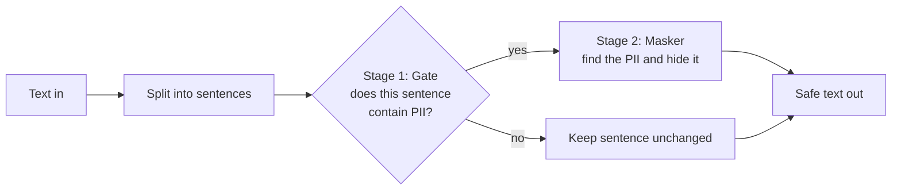
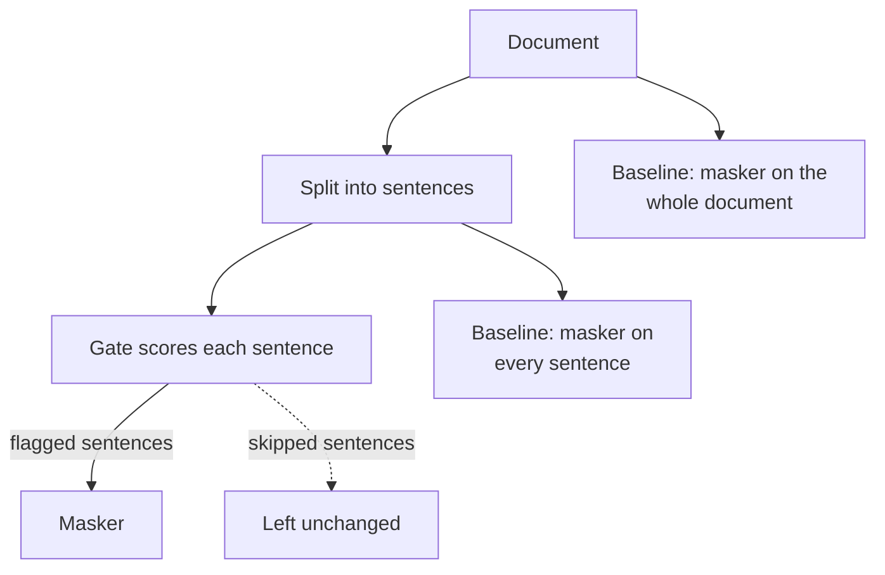

# pii-guardrail-qml

**A two-stage PII guardrail for LLMs.** Stage 1 detects sensitive information with quantum (simulated) and
classical classifiers; Stage 2 uses small language models to mask it and measures how much still leaks
under stress.

> Research name: *Clean F1 hides leaks: stress-testing small-language-model PII maskers, with a
> quantum-vs-classical benchmark for the PII gate.*

## 1. What problem does this solve?

People paste personal data (**PII**: names, emails, phone numbers, ID numbers) into text that is sent to
AI systems. A **guardrail** cleans the text first:

```
Input :  "Hi, I am Jane Smith. Call me on 555-0142 or write to jane@example.com."
Output:  "Hi, I am [NAME]. Call me on [PHONE] or write to [EMAIL]."
```

The hard part is not clean text like the example. It is text where the data is written in a tricky
way, for example `jane at example dot com`, or in another language. A model can score well on clean
text and still let that data through, which is why the title says *clean F1 hides leaks*.

## 2. How it works



- **Stage 1, the gate** answers a yes/no question per sentence. It is meant to be cheap, so the heavier
  masker only runs when needed. We compare **classical and (simulated) quantum** classifiers here.
- **Stage 2, the masker** finds the exact PII and replaces it with a label such as `[EMAIL]`. We compare a
  small encoder model against small language models.

The guardrail sits in front of the system that receives the text, so in principle it can protect any
LLM. We measured the guardrail itself; we did not connect it to a downstream chatbot.

## 3. What we compare

The two stages are **different problems**, so models are only compared inside their own stage.

| Stage | Task | Models compared |
|---|---|---|
| 1. Gate | sentence → "has PII? yes/no" | logistic regression, small MLP, **VQC** (quantum circuit), **quantum-kernel SVM** (angle and IQP encodings), plus a fine-tuned MiniLM as an upper bound |
| 2. Masker | document → exact PII spans | **DeBERTa-v3-small**, **Qwen2.5-0.5B + LoRA**, **SmolLM2-360M + LoRA**, and Qwen zero-shot (no training) as a baseline |

All gate models except the upper bound see the **same 8 numbers per sentence** (a compressed sentence
embedding), so the quantum-vs-classical comparison is fair. All quantum models run on a **classical
simulator**; no real quantum hardware was used.

## 4. How we test it: stress sets

Besides the normal test set, each masker is scored on harder text built from the held-out data:

| Stress set | What changes | Example |
|---|---|---|
| Obfuscated email / phone / name / ID | PII written in an unusual way | `jane at example dot com`, digits spelled as words, lowercase names with extra spaces, IDs with odd separators |
| Rare types | only the least frequent 30% of PII types in the training data | the types the model has seen least |
| Other languages | German, French, Italian text | same task, different language |
| Context-only | 50 hand-written examples where an identifier is only recognisable from the words around it | label `CONTEXT_ID`, never seen in training |

Two numbers are reported side by side:

- **Entity F1**: did the model find each piece of PII with the exact boundaries and the right label?
- **Character leak rate**: how much of the PII is still readable after masking? This is the privacy
  number. A model can have a decent F1 and still leak.

## 5. The combined pipeline

We also test the gate and masker together and compare different ways of running the masker:



| Arm | What runs the masker |
|---|---|
| `masker_doc` | the whole document, no gate |
| `masker_sent` | every sentence, no gate |
| `gate_*` | only sentences the gate flags (logistic regression, MLP, VQC or fine-tuned MiniLM) |
| `gate_oracle` | only sentences that truly contain PII (the best any gate could do) |

Comparing `masker_sent` with `gate_*` isolates what the gate itself costs.

## 6. Results

<!-- RESULTS:START (generated by scripts/make_report.py from results/; do not edit) -->
### Key findings

Generated from `results/` by `make report` (full profile). See [`reports/report.md`](reports/report.md) for confidence intervals, paired tests, per-set tables and limitations.

- Gate: VQC (exact) ROC-AUC 0.933 vs logistic regression 0.934 (difference -0.001); VQC trains in 21.0 s vs 0.002 s.
- Gate: fine-tuned MiniLM without the PCA bottleneck reaches ROC-AUC 0.995, against 0.935 for the 8-feature logistic regression (both trained on the full training pool).
- Barren plateau: mean gradient variance falls 66x from 2 to 8 qubits.
- Low data (n=50): Logistic regression 0.922, MLP 0.816, Quantum kernel SVM 0.923, VQC 0.908 ROC-AUC.
- VQC ablation: best variant `layers5` with ROC-AUC 0.935.
- Feature sweep: logistic regression goes from ROC-AUC 0.929 at k=4 to 0.963 at k=64.
- DeBERTa-v3-small: clean entity F1 0.917, character leak 0.011; worst stress-set F1 is 0.695 on `obf_all` (leak 0.051).
- Qwen2.5-0.5B + LoRA: clean entity F1 0.847, character leak 0.107; worst stress-set F1 is 0.762 on `cross_de` (leak 0.125).
- Pipeline (clean): masker on whole documents leaks 0.0124; on sentences 0.1554.
- Pipeline (clean) gate_logreg: skips 0.21 of sentences, leak 0.1620, latency p50 6.8 ms vs 3.3 ms masker-only.
- Pipeline (clean) gate_minilm_ft: skips 0.51 of sentences, leak 0.1586, latency p50 5.1 ms vs 3.3 ms masker-only.
- Pipeline (clean) gate_mlp: skips 0.18 of sentences, leak 0.1585, latency p50 6.9 ms vs 3.3 ms masker-only.
- Pipeline (clean) gate_vqc: skips 0.17 of sentences, leak 0.1577, latency p50 11.4 ms vs 3.3 ms masker-only.

### Stage 1: gate (simulated quantum vs classical, 8 shared features)

| model | accuracy | F1 | ROC-AUC | latency ms/sentence | seeds |
|---|---|---|---|---|---|
| Logistic regression | 0.871 | 0.871 | 0.934 | 0.0459 | 5 |
| MLP | 0.870 | 0.870 | 0.933 | 0.0442 | 5 |
| VQC (quantum, exact) | 0.869 | 0.872 | 0.933 | 4.34 | 5 |
| VQC (noise p=0.01) | 0.874 | 0.880 | 0.936 | 85 | 5 |
| Quantum kernel (angle) | 0.884 | 0.886 | 0.935 | 1.55 | 3 |
| Quantum kernel (IQP) | 0.816 | 0.833 | 0.905 | 5.25 | 3 |
| MiniLM fine-tuned (upper bound) | 0.978 | 0.979 | 0.995 | 1.14 | 3 |

### Stage 2: maskers (character leak = share of PII characters left unmasked)

| masker | seeds | F1 clean | F1 obfuscated | F1 rare | leak % clean | leak % obfuscated | latency p50 ms |
|---|---|---|---|---|---|---|---|
| DeBERTa-v3-small | 3 | 0.917 | 0.695 | 0.878 | 1.1 | 5.1 | 3.5 |
| Qwen2.5-0.5B + LoRA | 3 | 0.847 | 0.772 | 0.812 | 10.7 | 14.3 | 397.4 |
| SmolLM2-360M + LoRA | 3 | 0.792 | 0.735 | 0.765 | 13.2 | 21.8 | 596.0 |
| Qwen2.5-0.5B zero-shot | 1 | 0.008 | 0.009 | 0.015 | 59.7 | 61.9 | 491.7 |


### Two-stage pipeline (clean documents)

| arm | F1 | leak % | sentences skipped | latency p50 ms |
|---|---|---|---|---|
| gate_logreg | 0.788 | 16.20 | 0.21 | 6.8 |
| gate_minilm_ft | 0.789 | 15.86 | 0.51 | 5.1 |
| gate_mlp | 0.787 | 15.85 | 0.18 | 6.9 |
| gate_oracle | 0.797 | 15.54 | 0.55 | – |
| gate_vqc | 0.788 | 15.77 | 0.17 | 11.4 |
| masker_doc | 0.923 | 1.24 | – | 3.3 |
| masker_sent | 0.789 | 15.54 | 0.00 | 4.7 |

<!-- RESULTS:END -->

### Reading the results

- **Quantum results are classical simulations.** Their training time and latency are simulator timings,
  not hardware numbers.
- **F1 and leak rate answer different questions.** F1 asks whether each span was found exactly; the leak
  rate asks how much PII is still readable.
- **The gate is limited by its 8 input numbers**, not only by the model type. The fine-tuned MiniLM, which
  reads the whole sentence, is the upper bound.
- **Pipeline:** comparing `masker_sent` with each `gate_*` row isolates the gate. The gap between
  `masker_doc` and `masker_sent` is the cost of masking sentence by sentence, not the gate.
- Zero-shot has one seed; trained maskers have three. Confidence intervals, paired tests and extra quantum
  experiments (low data, depth, feature count) are in [`reports/report.md`](reports/report.md).

## 7. Run it

```bash
make setup      # install (uses uv)
make test       # unit tests, offline
make lint
make smoke      # tiny profile of each stage
make reproduce  # full profile; needs a CUDA GPU (the runs took a few hours in total)
```

Individual stages: `make data stress gate masker pipeline eval report`. The extra quantum experiments run
with `python scripts/run_quantum_extras.py --config configs/full.yaml`. The device is chosen automatically
(`cuda`, then `mps`, then `cpu`). Settings are in `configs/smoke.yaml` and `configs/full.yaml`.

Optional demo (needs `pip install gradio`): `python demo/app.py --config configs/full.yaml`.

**Honesty rule:** every number in `reports/` and in the results section above comes from files in
`results/`; `make report` regenerates both. Nothing is typed by hand.

## 8. Project layout

```
configs/                 smoke.yaml (quick) and full.yaml (real runs)
scripts/                 one entry point per phase (prepare_data, run_stress, run_gate, run_masker,
                         run_pipeline, run_eval, run_quantum_extras, make_report)
src/piiguard/data/       loading, labels, sentences, stress sets, training pairs
src/piiguard/gate/       classical models, VQC, quantum kernel, MiniLM, metrics
src/piiguard/masker/     DeBERTa, LoRA fine-tuning, LLM inference, span parsing
src/piiguard/pipeline/   gates, assembly of the two stages, demo core
src/piiguard/eval/       metrics and bootstrap confidence intervals
results/                 run records and summary tables      reports/   report.md and figures
```

The original task description is in [`PROJECT_BRIEF.md`](PROJECT_BRIEF.md).

## 9. Limitations

- All quantum results are **simulated**; real hardware was not used.
- The dataset (`ai4privacy/pii-masking-300k`) is **synthetic**; results may not transfer to real text.
- The gate sees only **8 numbers per sentence**, which caps every gate model except the upper bound.
- Language-model maskers return PII as text and I locate it by **exact string matching**, which can
  over-mask repeated words and miss altered strings.
- Masking **sentence by sentence** leaks more than masking whole documents (see the pipeline table).
- The 50 context-only examples are hand-written and have not been independently reviewed.
- The guardrail was **not tested with a downstream LLM**.

## 10. Dataset license

Data comes from [`ai4privacy/pii-masking-300k`](https://huggingface.co/datasets/ai4privacy/pii-masking-300k),
which carries its own license and terms. Check the dataset card before redistributing any derived data.
Processed data is git-ignored here.
