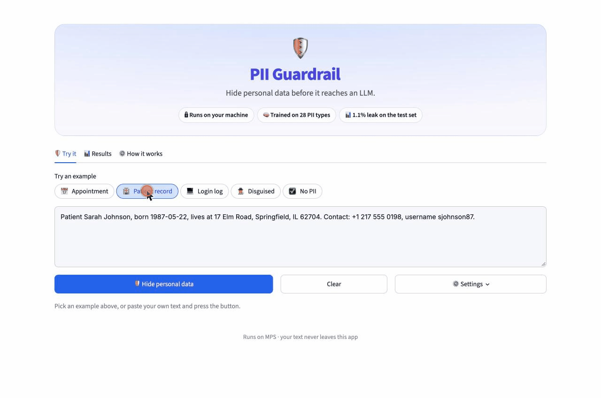
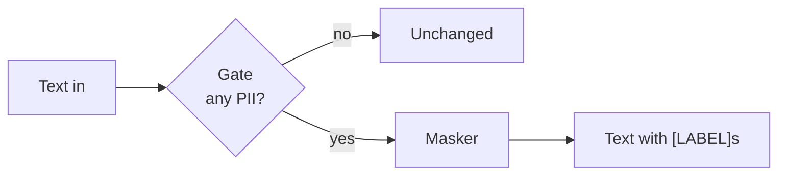
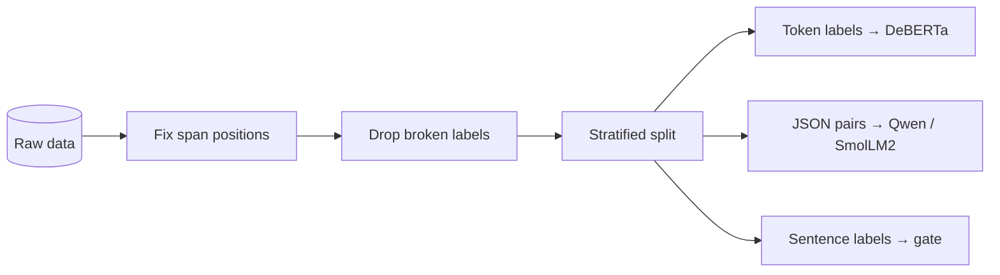

<div align="center">

# 🛡️ PII Guardrail

### Hide personal data before it reaches an LLM.

A fast gate (classical vs simulated quantum) plus a trained masker (DeBERTa, Qwen, SmolLM2).


[](LICENSE)

[Example](#-example) · [How it works](#%EF%B8%8F-how-it-works) · [Quick start](#-quick-start) · [Data](#-data) · [Results](#-results)

</div>

<p align="center">
  
  <br />
  <sub>The Streamlit app running the trained DeBERTa model locally. Every result is real model output.</sub>
</p>

---

## 🔎 Example

Real output of the trained DeBERTa masker:

```text
In : Hi, I am Jane Smith. Call me on 555-0142 or write to jane@example.com.
Out: Hi, I am Jane Smith. Call me on 555-01[TEL] or write to [EMAIL].
```

It missed the name and part of the phone number. That's why we measure the **leak rate** (the share of PII characters left readable), not only F1.

## ⚙️ How it works



| | Step | What happens |
|:-:|---|---|
| 1 | **Data** | Clean and split ai4privacy. Build disguised, rare-type and other-language test sets. |
| 2 | **Gate** | Sentence → "has PII?" Classical models vs a quantum circuit (VQC), with the same 8 features. |
| 3 | **Masker** | DeBERTa-v3-small, plus Qwen2.5-0.5B and SmolLM2-360M fine-tuned with LoRA. |
| 4 | **Evaluate** | F1, leak rate and latency, with 95% confidence intervals. |

## 🚀 Quick start

**Needs:** Python 3.11 or 3.12, [uv](https://docs.astral.sh/uv/), and a CUDA GPU for training (a CPU is fine for running the app). The dataset downloads automatically from Hugging Face.

**1. Install**

```bash
git clone https://github.com/atique-ahmad-01/pii-guardrail-qml && cd pii-guardrail-qml
make setup && uv pip install -r app/requirements.txt
```

**2a. Download the trained weights** (fastest)

| File | What it is | Size | Needed? |
|---|---|---|---|
| [pii-guardrail-deberta.zip](https://github.com/atique-ahmad-01/pii-guardrail-qml/releases/download/weights-v1/pii-guardrail-deberta.zip) | DeBERTa masker, the recommended one | 425 MB | ✅ yes |
| [pii-guardrail-gates.zip](https://github.com/atique-ahmad-01/pii-guardrail-qml/releases/download/weights-v1/pii-guardrail-gates.zip) | all gates (logistic regression, MLP, VQC, MiniLM) | 159 MB | ✅ yes |
| [pii-guardrail-qwen-lora.zip](https://github.com/atique-ahmad-01/pii-guardrail-qml/releases/download/weights-v1/pii-guardrail-qwen-lora.zip) | Qwen2.5-0.5B + LoRA masker | 750 MB | optional |
| [pii-guardrail-smollm-lora.zip](https://github.com/atique-ahmad-01/pii-guardrail-qml/releases/download/weights-v1/pii-guardrail-smollm-lora.zip) | SmolLM2-360M + LoRA masker | 548 MB | optional |

All files are on the [weights-v1 release](https://github.com/atique-ahmad-01/pii-guardrail-qml/releases/tag/weights-v1). Download and unzip them in the repository root, and they fill `checkpoints/`:

```bash
for f in deberta gates; do
  curl -LO https://github.com/atique-ahmad-01/pii-guardrail-qml/releases/download/weights-v1/pii-guardrail-$f.zip && unzip -q pii-guardrail-$f.zip
done
```

Checksums are in [`SHA256SUMS.txt`](SHA256SUMS.txt). The weights were trained on ai4privacy data, so they are for **academic and non-commercial use only**, under the [dataset's license](https://huggingface.co/datasets/ai4privacy/pii-masking-300k). Credit AI4Privacy if you use them.

**2b. Or train your own weights** (choose one)

```bash
# Fast: the best masker (DeBERTa) and the gates only (DeBERTa trained in about 1 min on an RTX 5070 Ti)
make data stress PROFILE=full
uv run python scripts/run_masker.py --config configs/full.yaml --model deberta --seeds 2
uv run python scripts/export_gates.py --config configs/full.yaml

# Full: every model and the whole evaluation, a few hours on one GPU
make reproduce

# Then, for either one: package the models for the app
uv run python scripts/package_checkpoints.py --src checkpoints --out checkpoints
```

**3. Run**

```bash
uv run streamlit run app/streamlit_app.py     # app at localhost:8501
uv run python scripts/infer.py --masker checkpoints/masker/001_deberta --text "Call me on 555-0142"
uv run python scripts/serve.py --masker checkpoints/masker/001_deberta --port 8000   # JSON API
```

`make smoke` runs a tiny version of every step in a few minutes, as a check that everything is installed correctly.

## 📚 Data

**[ai4privacy/pii-masking-300k](https://huggingface.co/datasets/ai4privacy/pii-masking-300k)**: synthetic text with 28 PII types, each labelled with its exact position. It has the same kind of text in English, German, French and Italian, and contains no real people's data.

| Split | Docs | Used for |
|---|---|---|
| train (English) | 5,000 | training |
| val (English) | 1,000 | early stopping, thresholds |
| **test (English)** | 1,000 | **all reported scores** |
| German / French / Italian | 1,000 each | testing other languages |



## 📊 Results

**Masker** (English test set)

| Model | F1 | Leak | Leak (disguised PII) | ms / doc |
|---|---|---|---|---|
| **DeBERTa-v3-small** | **0.917** | **1.1%** | **5.1%** | **3.5** |
| Qwen2.5-0.5B + LoRA | 0.847 | 10.7% | 14.3% | 397 |
| SmolLM2-360M + LoRA | 0.792 | 13.2% | 21.8% | 596 |
| Qwen2.5-0.5B, untrained | 0.008 | 59.7% | 61.9% | 492 |


**Gate**

| Model | ROC-AUC | ms / sentence |
|---|---|---|
| Logistic regression | 0.934 | 0.05 |
| VQC (quantum, simulated) | 0.933 | 4.34 |
| MiniLM fine-tuned | **0.995** | 1.14 |

**Takeaways**

- Training is essential: the untrained model leaks 59.7% of PII.
- DeBERTa leaks the least and is the fastest.
- Quantum matches classical but doesn't beat it.

Full details: [`reports/report.md`](reports/report.md).

> Quantum results are from a simulator. The data is synthetic. The app and API have no login.

<div align="center">
<sub>Built by <a href="https://github.com/atique-ahmad-01">Atique Ahmad</a> · code under the <a href="LICENSE">MIT license</a> · trained weights for non-commercial use (ai4privacy data)</sub>
</div>
