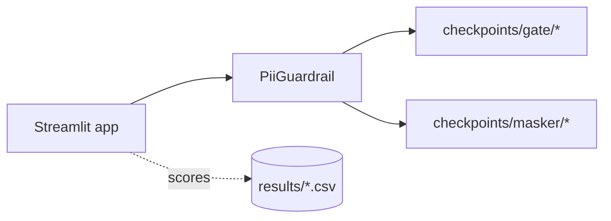

# PII Guardrail app (Streamlit)

A small, self-contained UI for trying the trained models on your own text. It is separate from the
research code: it does no training or evaluation and only calls `piiguard.inference.PiiGuardrail`.



## Run

```bash
# from the repository root, inside the project environment
uv pip install -r app/requirements.txt
streamlit run app/streamlit_app.py           # http://localhost:8501
```

Options: `streamlit run app/streamlit_app.py -- --checkpoints <dir>` or set
`PIIGUARD_CHECKPOINTS=<dir>` to load models from another folder. Add
`--server.address localhost` to keep the app private to this machine.

## What you can do

| Tab | Purpose |
|---|---|
| 🛡️ **Mask text** | Paste text or pick an example, press **Mask**. See the PII highlighted by type, the masked output (copy or download), every span, and the gate's score for each sentence. |
| ⚖️ **Compare maskers** | Run several maskers on the same text side by side, with latency and the number of spans each one found. |
| 📊 **Model scores** | Test-set F1 and leak rate for each masker (clean, disguised, rare, German) and ROC-AUC and latency for each gate, read from `results/`. |
| ℹ️ **How it works** | The two stages, the three modes, and what the scores mean. |

In the sidebar you choose each stage independently:

- **Masker** (finds and hides PII): DeBERTa-v3-small, Qwen2.5-0.5B + LoRA, SmolLM2-360M + LoRA.
- **Gate** (quick "is there PII?" check): none, logistic regression, MLP, quantum circuit (VQC,
  simulated), fine-tuned MiniLM.
- **Mode**: *Whole text* (safest, default), *Gate, then whole text* (skips text the gate thinks is
  clean), *Flagged sentences only* (fastest, but measured to leak much more).

## Models

The app reads the packaged folders (built with `scripts/package_checkpoints.py`, see the main README):

```
checkpoints/
├── masker/
│   ├── 001_deberta/         DeBERTa-v3-small token classifier
│   ├── 002_qwen_lora/       Qwen2.5-0.5B with its LoRA adapter merged in
│   └── 003_smollm_lora/     SmolLM2-360M with its LoRA adapter merged in
└── gate/
    ├── shared/              thresholds, PCA feature scaler, MiniLM encoder
    ├── 001_logreg/  002_mlp/  003_vqc/  004_minilm_ft/
```

Any folder added under `masker/` (a DeBERTa model, a merged language model or a LoRA adapter) appears
in the list automatically. Each model loads once and stays in memory, so only the first request is slow.

## Notes

- **Privacy:** text is processed in memory on the machine running the app and is not saved. The app has
  no login; do not expose it on a network without authentication and HTTPS.
- **Speed:** DeBERTa needs well under a second per text on a CPU. The language-model maskers take
  several seconds per text on a CPU; a GPU is recommended for them.
- **Limits:** the models were trained on a synthetic dataset and can miss PII, especially when it is
  disguised. Treat the output as a safety net, not a guarantee.
