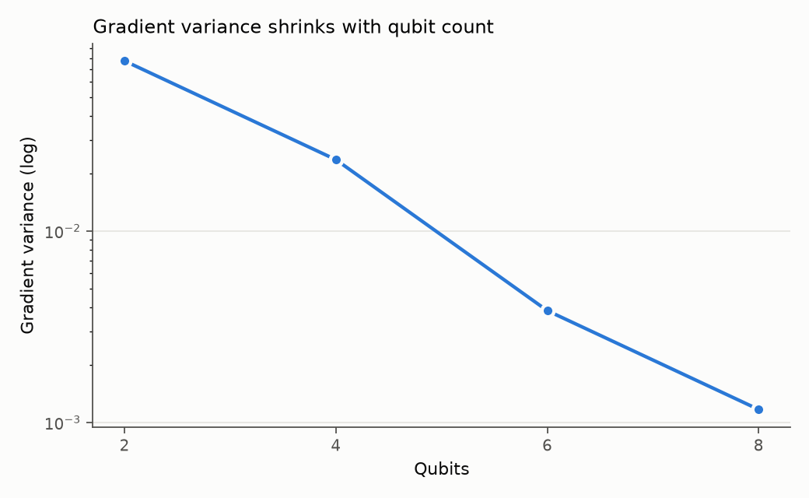
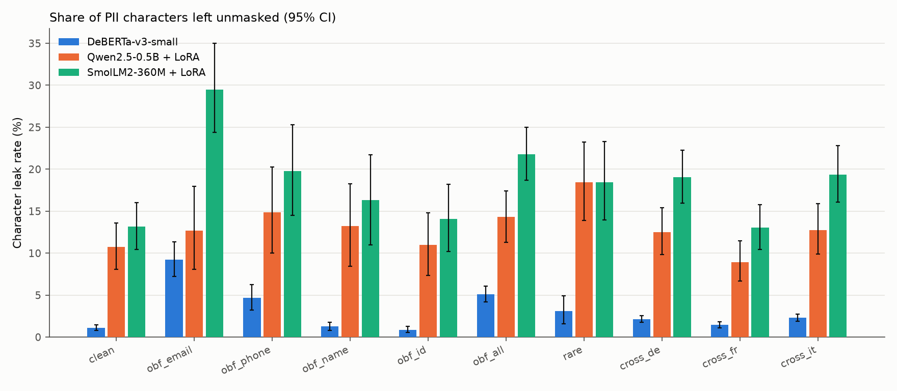
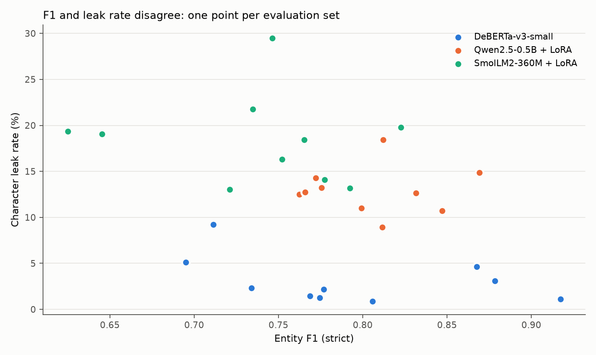
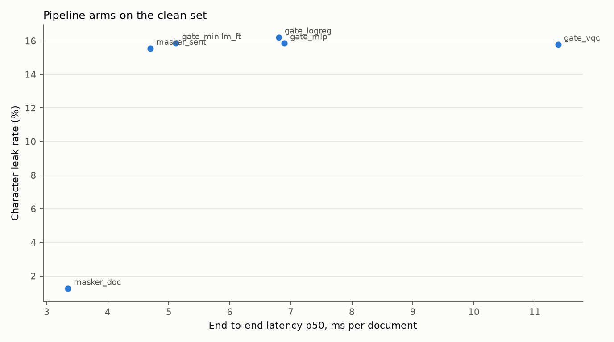

# Clean F1 hides leaks: stress-testing small-language-model PII maskers, with a quantum-vs-classical benchmark for the PII gate

_Generated from `/Users/ebricks/Desktop/pii-guardrail-qml/results` by `scripts/make_report.py`; every number below is read from a results file._

## Key results

- Gate: VQC (exact) ROC-AUC 0.933 vs logistic regression 0.934 (difference -0.001); VQC trains in 21.0 s vs 0.002 s.
- Gate: fine-tuned MiniLM without the PCA bottleneck reaches ROC-AUC 0.995, against 0.935 for the 8-feature logistic regression (both trained on the full training pool).
- Barren plateau: mean gradient variance falls 66x from 2 to 8 qubits.
- DeBERTa-v3-small: clean entity F1 0.917, character leak 0.011; worst stress-set F1 is 0.695 on `obf_all` (leak 0.051).
- Qwen2.5-0.5B + LoRA: clean entity F1 0.847, character leak 0.107; worst stress-set F1 is 0.762 on `cross_de` (leak 0.125).
- Pipeline (clean): masker on whole documents leaks 0.0124; on sentences 0.1554.
- Pipeline (clean) gate_logreg: skips 0.21 of sentences, leak 0.1620, latency p50 6.8 ms vs 3.3 ms masker-only.
- Pipeline (clean) gate_minilm_ft: skips 0.51 of sentences, leak 0.1586, latency p50 5.1 ms vs 3.3 ms masker-only.
- Pipeline (clean) gate_mlp: skips 0.18 of sentences, leak 0.1585, latency p50 6.9 ms vs 3.3 ms masker-only.
- Pipeline (clean) gate_vqc: skips 0.17 of sentences, leak 0.1577, latency p50 11.4 ms vs 3.3 ms masker-only.

## Stage 1: PII gate (quantum vs classical)

All 8-feature models see identical inputs: MiniLM-L6-v2 embeddings reduced by PCA to 8 dimensions, which keeps **27.4%** of the embedding variance. Mean ± std over seeds; evaluation on the shared balanced test subset (`n2000`/`full` = training-set size; `n500` = kernel train cap). Latency and training time are simulator wall-clock numbers, not hardware numbers.

| model | setting | size | n_seeds | accuracy | AUC | PR_AUC | recall@95%prec | train s | latency ms/sent | params |
|---|---|---|---|---|---|---|---|---|---|---|
| logreg | classical | full | 5 | 0.874 ± 0.000 | 0.935 ± 0.000 | 0.917 ± 0.000 | 0.29 ± 0.00 | 0.0207 | 0.0458 | 9 |
| logreg | classical | n2000 | 5 | 0.871 ± 0.002 | 0.934 ± 0.001 | 0.916 ± 0.001 | 0.27 ± 0.04 | 0.00241 | 0.0459 | 9 |
| minilm_finetuned | raw_text | full | 3 | 0.978 ± 0.001 | 0.995 ± 0.001 | 0.993 ± 0.001 | 1.00 ± 0.00 | 35.3 | 1.14 | 22,713,601 |
| minilm_finetuned | raw_text | n2000 | 3 | 0.948 ± 0.008 | 0.984 ± 0.002 | 0.979 ± 0.002 | 0.94 ± 0.02 | 1.54 | 1.13 | 22,713,601 |
| mlp | classical | full | 5 | 0.890 ± 0.004 | 0.944 ± 0.002 | 0.923 ± 0.004 | 0.34 ± 0.07 | 2.36 | 0.044 | 71 |
| mlp | classical | n2000 | 5 | 0.870 ± 0.005 | 0.933 ± 0.004 | 0.916 ± 0.003 | 0.31 ± 0.05 | 0.253 | 0.0442 | 71 |
| qkernel_angle | exact | n500 | 3 | 0.884 ± 0.010 | 0.935 ± 0.001 | 0.919 ± 0.009 | 0.21 ± 0.18 | 0.0591 | 1.55 | 0 |
| qkernel_angle | shots1024 | n500 | 3 | 0.877 ± 0.004 | 0.933 ± 0.001 | 0.919 ± 0.004 | 0.21 ± 0.13 | 0.0767 | 2.39 | 0 |
| qkernel_iqp | exact | n500 | 3 | 0.816 ± 0.004 | 0.905 ± 0.003 | 0.894 ± 0.004 | 0.28 ± 0.01 | 0.342 | 5.25 | 0 |
| qkernel_iqp | shots1024 | n500 | 3 | 0.811 ± 0.006 | 0.901 ± 0.005 | 0.887 ± 0.005 | 0.25 ± 0.02 | 0.39 | 5.31 | 0 |
| vqc | exact | n2000 | 5 | 0.869 ± 0.005 | 0.933 ± 0.002 | 0.916 ± 0.004 | 0.28 ± 0.06 | 21 | 4.34 | 74 |
| vqc | noisy_p0.001 | n2000 | 5 | 0.870 ± 0.009 | 0.936 ± 0.002 | 0.915 ± 0.007 | 0.29 ± 0.14 | 21 | 84.7 | 74 |
| vqc | noisy_p0.01 | n2000 | 5 | 0.874 ± 0.006 | 0.936 ± 0.002 | 0.914 ± 0.008 | 0.25 ± 0.10 | 21 | 85 | 74 |
| vqc | shots1024 | n2000 | 5 | 0.864 ± 0.009 | 0.931 ± 0.004 | 0.913 ± 0.006 | 0.22 ± 0.07 | 21 | 4.24 | 74 |


The 8-feature models span ROC-AUC 0.901–0.944; the fine-tuned MiniLM is the only model outside that range.

### Barren-plateau check

Variance of ∂⟨Z₀⟩/∂θ over random initialisations (3 layers):

| n_qubits | n_layers | n_samples | var_first_param | var_mean_all_params |
|---|---|---|---|---|
| 2.0 | 3.0 | 200.0 | 8.96e-02 | 7.74e-02 |
| 4.0 | 3.0 | 200.0 | 2.00e-02 | 2.36e-02 |
| 6.0 | 3.0 | 200.0 | 2.91e-03 | 3.84e-03 |
| 8.0 | 3.0 | 200.0 | 1.25e-03 | 1.17e-03 |





## Additional quantum scenarios

_Not run (`results/gate_extras/` missing)._

## Stage 2: PII maskers

Entity F1 is strict (exact span and label). **Character leak rate** is the share of gold PII characters not covered by any predicted mask, whatever its type. Values are seed-averaged with 95% bootstrap CIs over documents (seeds share the resample). `n_seeds` is the number of training seeds behind each row.

### Entity F1

| set | DeBERTa-v3-small | Qwen2.5-0.5B + LoRA | Qwen2.5-0.5B zero-shot | SmolLM2-360M + LoRA |
|---|---|---|---|---|
| clean | 0.917 [0.907, 0.927] | 0.847 [0.827, 0.865] | 0.008 [0.003, 0.016] | 0.792 [0.772, 0.813] |
| obf_email | 0.711 [0.680, 0.741] | 0.832 [0.792, 0.867] | 0.000 [0.000, 0.000] | 0.746 [0.704, 0.785] |
| obf_phone | 0.868 [0.846, 0.888] | 0.869 [0.832, 0.902] | 0.015 [0.002, 0.032] | 0.823 [0.784, 0.858] |
| obf_name | 0.774 [0.750, 0.798] | 0.776 [0.741, 0.808] | 0.009 [0.001, 0.023] | 0.752 [0.717, 0.785] |
| obf_id | 0.806 [0.781, 0.830] | 0.799 [0.770, 0.828] | 0.010 [0.002, 0.022] | 0.777 [0.748, 0.805] |
| obf_all | 0.695 [0.675, 0.716] | 0.772 [0.748, 0.795] | 0.009 [0.002, 0.017] | 0.735 [0.710, 0.758] |
| rare | 0.878 [0.856, 0.901] | 0.812 [0.778, 0.847] | 0.015 [0.000, 0.034] | 0.765 [0.729, 0.799] |
| cross_de | 0.777 [0.761, 0.793] | 0.762 [0.741, 0.783] | 0.009 [0.004, 0.016] | 0.645 [0.623, 0.668] |
| cross_fr | 0.769 [0.754, 0.783] | 0.812 [0.792, 0.831] | 0.009 [0.004, 0.016] | 0.721 [0.699, 0.742] |
| cross_it | 0.734 [0.719, 0.749] | 0.766 [0.745, 0.785] | 0.013 [0.008, 0.019] | 0.625 [0.601, 0.648] |
| context_only | 0.000 [0.000, 0.000] | 0.000 [0.000, 0.000] | 0.000 [0.000, 0.000] | 0.000 [0.000, 0.000] |

### Character leak rate

| set | DeBERTa-v3-small | Qwen2.5-0.5B + LoRA | Qwen2.5-0.5B zero-shot | SmolLM2-360M + LoRA |
|---|---|---|---|---|
| clean | 0.011 [0.008, 0.015] | 0.107 [0.081, 0.136] | 0.597 [0.573, 0.621] | 0.132 [0.104, 0.160] |
| obf_email | 0.092 [0.072, 0.113] | 0.127 [0.081, 0.180] | 0.586 [0.537, 0.631] | 0.295 [0.244, 0.350] |
| obf_phone | 0.047 [0.032, 0.063] | 0.149 [0.100, 0.203] | 0.637 [0.582, 0.689] | 0.198 [0.145, 0.253] |
| obf_name | 0.013 [0.008, 0.018] | 0.132 [0.084, 0.183] | 0.642 [0.604, 0.680] | 0.163 [0.110, 0.217] |
| obf_id | 0.009 [0.005, 0.013] | 0.110 [0.074, 0.148] | 0.588 [0.556, 0.620] | 0.141 [0.102, 0.182] |
| obf_all | 0.051 [0.042, 0.061] | 0.143 [0.113, 0.174] | 0.619 [0.593, 0.645] | 0.218 [0.187, 0.250] |
| rare | 0.031 [0.016, 0.049] | 0.184 [0.139, 0.232] | 0.718 [0.679, 0.755] | 0.184 [0.139, 0.233] |
| cross_de | 0.022 [0.018, 0.026] | 0.125 [0.098, 0.154] | 0.622 [0.597, 0.647] | 0.191 [0.160, 0.223] |
| cross_fr | 0.015 [0.011, 0.019] | 0.089 [0.067, 0.115] | 0.634 [0.611, 0.656] | 0.130 [0.105, 0.158] |
| cross_it | 0.023 [0.019, 0.028] | 0.127 [0.099, 0.159] | 0.625 [0.602, 0.649] | 0.193 [0.161, 0.228] |
| context_only | 0.929 [0.909, 0.947] | 0.891 [0.859, 0.920] | 0.697 [0.636, 0.759] | 0.929 [0.909, 0.948] |

Seeds per model: DeBERTa-v3-small = 3, Qwen2.5-0.5B + LoRA = 3, Qwen2.5-0.5B zero-shot = 1, SmolLM2-360M + LoRA = 3.





### Change relative to the clean test set

Different documents, so the bootstrap is unpaired.

| model | set | metric | diff vs clean [95% CI] | p |
|---|---|---|---|---|
| DeBERTa-v3-small | context_only | entity_f1 | -0.917 [-0.927, -0.907] | 0.0002 |
| DeBERTa-v3-small | context_only | char_leak_rate | +0.918 [+0.898, +0.936] | 0.0002 |
| DeBERTa-v3-small | cross_de | entity_f1 | -0.141 [-0.159, -0.122] | 0.0002 |
| DeBERTa-v3-small | cross_de | char_leak_rate | +0.010 [+0.005, +0.016] | 0.0002 |
| DeBERTa-v3-small | cross_fr | entity_f1 | -0.149 [-0.167, -0.131] | 0.0002 |
| DeBERTa-v3-small | cross_fr | char_leak_rate | +0.004 [-0.002, +0.009] | 0.181 |
| DeBERTa-v3-small | cross_it | entity_f1 | -0.183 [-0.202, -0.165] | 0.0002 |
| DeBERTa-v3-small | cross_it | char_leak_rate | +0.012 [+0.006, +0.017] | 0.0002 |
| DeBERTa-v3-small | obf_all | entity_f1 | -0.222 [-0.245, -0.199] | 0.0002 |
| DeBERTa-v3-small | obf_all | char_leak_rate | +0.040 [+0.030, +0.050] | 0.0002 |
| DeBERTa-v3-small | obf_email | entity_f1 | -0.206 [-0.238, -0.175] | 0.0002 |
| DeBERTa-v3-small | obf_email | char_leak_rate | +0.081 [+0.061, +0.102] | 0.0002 |
| DeBERTa-v3-small | obf_id | entity_f1 | -0.112 [-0.138, -0.085] | 0.0002 |
| DeBERTa-v3-small | obf_id | char_leak_rate | -0.002 [-0.007, +0.003] | 0.352 |
| DeBERTa-v3-small | obf_name | entity_f1 | -0.143 [-0.171, -0.117] | 0.0002 |
| DeBERTa-v3-small | obf_name | char_leak_rate | +0.002 [-0.004, +0.007] | 0.608 |
| DeBERTa-v3-small | obf_phone | entity_f1 | -0.050 [-0.073, -0.026] | 0.0002 |
| DeBERTa-v3-small | obf_phone | char_leak_rate | +0.035 [+0.021, +0.052] | 0.0002 |
| DeBERTa-v3-small | rare | entity_f1 | -0.039 [-0.063, -0.014] | 0.0024 |
| DeBERTa-v3-small | rare | char_leak_rate | +0.020 [+0.004, +0.038] | 0.0084 |
| Qwen2.5-0.5B + LoRA | context_only | entity_f1 | -0.847 [-0.865, -0.827] | 0.0002 |
| Qwen2.5-0.5B + LoRA | context_only | char_leak_rate | +0.784 [+0.741, +0.824] | 0.0002 |
| Qwen2.5-0.5B + LoRA | cross_de | entity_f1 | -0.085 [-0.113, -0.056] | 0.0002 |
| Qwen2.5-0.5B + LoRA | cross_de | char_leak_rate | +0.018 [-0.021, +0.058] | 0.367 |
| Qwen2.5-0.5B + LoRA | cross_fr | entity_f1 | -0.035 [-0.063, -0.008] | 0.0108 |
| Qwen2.5-0.5B + LoRA | cross_fr | char_leak_rate | -0.018 [-0.054, +0.017] | 0.319 |
| Qwen2.5-0.5B + LoRA | cross_it | entity_f1 | -0.081 [-0.108, -0.053] | 0.0002 |
| Qwen2.5-0.5B + LoRA | cross_it | char_leak_rate | +0.020 [-0.021, +0.061] | 0.34 |
| Qwen2.5-0.5B + LoRA | obf_all | entity_f1 | -0.075 [-0.106, -0.044] | 0.0002 |
| Qwen2.5-0.5B + LoRA | obf_all | char_leak_rate | +0.036 [-0.006, +0.076] | 0.0924 |
| Qwen2.5-0.5B + LoRA | obf_email | entity_f1 | -0.015 [-0.059, +0.026] | 0.503 |
| Qwen2.5-0.5B + LoRA | obf_email | char_leak_rate | +0.019 [-0.035, +0.078] | 0.532 |
| Qwen2.5-0.5B + LoRA | obf_id | entity_f1 | -0.048 [-0.082, -0.013] | 0.0076 |
| Qwen2.5-0.5B + LoRA | obf_id | char_leak_rate | +0.002 [-0.043, +0.048] | 0.94 |
| Qwen2.5-0.5B + LoRA | obf_name | entity_f1 | -0.071 [-0.112, -0.033] | 0.0004 |
| Qwen2.5-0.5B + LoRA | obf_name | char_leak_rate | +0.025 [-0.031, +0.083] | 0.396 |
| Qwen2.5-0.5B + LoRA | obf_phone | entity_f1 | +0.022 [-0.020, +0.061] | 0.276 |
| Qwen2.5-0.5B + LoRA | obf_phone | char_leak_rate | +0.041 [-0.016, +0.101] | 0.166 |
| Qwen2.5-0.5B + LoRA | rare | entity_f1 | -0.035 [-0.074, +0.006] | 0.0924 |
| Qwen2.5-0.5B + LoRA | rare | char_leak_rate | +0.077 [+0.022, +0.129] | 0.0052 |
| SmolLM2-360M + LoRA | context_only | entity_f1 | -0.792 [-0.813, -0.772] | 0.0002 |
| SmolLM2-360M + LoRA | context_only | char_leak_rate | +0.797 [+0.762, +0.831] | 0.0002 |
| SmolLM2-360M + LoRA | cross_de | entity_f1 | -0.147 [-0.178, -0.115] | 0.0002 |
| SmolLM2-360M + LoRA | cross_de | char_leak_rate | +0.059 [+0.017, +0.101] | 0.0084 |
| SmolLM2-360M + LoRA | cross_fr | entity_f1 | -0.071 [-0.101, -0.040] | 0.0002 |
| SmolLM2-360M + LoRA | cross_fr | char_leak_rate | -0.001 [-0.040, +0.037] | 0.922 |
| SmolLM2-360M + LoRA | cross_it | entity_f1 | -0.168 [-0.198, -0.135] | 0.0002 |
| SmolLM2-360M + LoRA | cross_it | char_leak_rate | +0.061 [+0.017, +0.104] | 0.008 |
| SmolLM2-360M + LoRA | obf_all | entity_f1 | -0.058 [-0.090, -0.026] | 0.0008 |
| SmolLM2-360M + LoRA | obf_all | char_leak_rate | +0.086 [+0.043, +0.128] | 0.0002 |
| SmolLM2-360M + LoRA | obf_email | entity_f1 | -0.046 [-0.093, -0.002] | 0.0396 |
| SmolLM2-360M + LoRA | obf_email | char_leak_rate | +0.163 [+0.103, +0.224] | 0.0002 |
| SmolLM2-360M + LoRA | obf_id | entity_f1 | -0.015 [-0.050, +0.019] | 0.404 |
| SmolLM2-360M + LoRA | obf_id | char_leak_rate | +0.009 [-0.039, +0.059] | 0.728 |
| SmolLM2-360M + LoRA | obf_name | entity_f1 | -0.040 [-0.082, +0.000] | 0.0512 |
| SmolLM2-360M + LoRA | obf_name | char_leak_rate | +0.031 [-0.031, +0.094] | 0.316 |
| SmolLM2-360M + LoRA | obf_phone | entity_f1 | +0.030 [-0.014, +0.072] | 0.179 |
| SmolLM2-360M + LoRA | obf_phone | char_leak_rate | +0.066 [+0.005, +0.129] | 0.0324 |
| SmolLM2-360M + LoRA | rare | entity_f1 | -0.027 [-0.068, +0.014] | 0.183 |
| SmolLM2-360M + LoRA | rare | char_leak_rate | +0.052 [-0.002, +0.108] | 0.0588 |

### Paired comparisons between maskers

Same documents; two-sided paired bootstrap; `p_holm` is Holm-adjusted within each metric.

| model_a | model_b | set | metric | a − b [95% CI] | p | p_holm |
|---|---|---|---|---|---|---|
| deberta | qwen_lora | clean | entity_f1 | +0.070 [+0.054, +0.087] | 0.0002 | 0.0088 |
| deberta | qwen_lora | clean | char_leak_rate | -0.096 [-0.125, -0.070] | 0.0002 | 0.0088 |
| deberta | qwen_lora | context_only | entity_f1 | +0.000 [+0.000, +0.000] | 1 | 1 |
| deberta | qwen_lora | context_only | char_leak_rate | +0.038 [+0.014, +0.064] | 0.0012 | 0.0108 |
| deberta | qwen_lora | cross_de | entity_f1 | +0.015 [-0.005, +0.035] | 0.17 | 1 |
| deberta | qwen_lora | cross_de | char_leak_rate | -0.104 [-0.133, -0.077] | 0.0002 | 0.0088 |
| deberta | qwen_lora | cross_fr | entity_f1 | -0.043 [-0.059, -0.027] | 0.0002 | 0.0088 |
| deberta | qwen_lora | cross_fr | char_leak_rate | -0.074 [-0.098, -0.053] | 0.0002 | 0.0088 |
| deberta | qwen_lora | cross_it | entity_f1 | -0.032 [-0.051, -0.012] | 0.0012 | 0.0192 |
| deberta | qwen_lora | cross_it | char_leak_rate | -0.104 [-0.137, -0.075] | 0.0002 | 0.0088 |
| deberta | qwen_lora | obf_all | entity_f1 | -0.077 [-0.098, -0.055] | 0.0002 | 0.0088 |
| deberta | qwen_lora | obf_all | char_leak_rate | -0.092 [-0.123, -0.062] | 0.0002 | 0.0088 |
| deberta | qwen_lora | obf_email | entity_f1 | -0.120 [-0.159, -0.080] | 0.0002 | 0.0088 |
| deberta | qwen_lora | obf_email | char_leak_rate | -0.034 [-0.087, +0.012] | 0.168 | 0.504 |
| deberta | qwen_lora | obf_id | entity_f1 | +0.006 [-0.014, +0.028] | 0.558 | 1 |
| deberta | qwen_lora | obf_id | char_leak_rate | -0.101 [-0.139, -0.066] | 0.0002 | 0.0088 |
| deberta | qwen_lora | obf_name | entity_f1 | -0.001 [-0.028, +0.028] | 0.93 | 1 |
| deberta | qwen_lora | obf_name | char_leak_rate | -0.120 [-0.174, -0.072] | 0.0002 | 0.0088 |
| deberta | qwen_lora | obf_phone | entity_f1 | -0.001 [-0.031, +0.033] | 0.872 | 1 |
| deberta | qwen_lora | obf_phone | char_leak_rate | -0.102 [-0.158, -0.052] | 0.0002 | 0.0088 |
| deberta | qwen_lora | rare | entity_f1 | +0.066 [+0.030, +0.104] | 0.0002 | 0.0088 |
| deberta | qwen_lora | rare | char_leak_rate | -0.153 [-0.203, -0.108] | 0.0002 | 0.0088 |
| deberta | smollm_lora | clean | entity_f1 | +0.125 [+0.106, +0.145] | 0.0002 | 0.0088 |
| deberta | smollm_lora | clean | char_leak_rate | -0.121 [-0.150, -0.094] | 0.0002 | 0.0088 |
| deberta | smollm_lora | context_only | entity_f1 | +0.000 [+0.000, +0.000] | 1 | 1 |
| deberta | smollm_lora | context_only | char_leak_rate | -0.000 [-0.016, +0.016] | 0.948 | 1 |
| deberta | smollm_lora | cross_de | entity_f1 | +0.131 [+0.111, +0.152] | 0.0002 | 0.0088 |
| deberta | smollm_lora | cross_de | char_leak_rate | -0.169 [-0.200, -0.138] | 0.0002 | 0.0088 |
| deberta | smollm_lora | cross_fr | entity_f1 | +0.048 [+0.030, +0.066] | 0.0002 | 0.0088 |
| deberta | smollm_lora | cross_fr | char_leak_rate | -0.116 [-0.142, -0.090] | 0.0002 | 0.0088 |
| deberta | smollm_lora | cross_it | entity_f1 | +0.109 [+0.088, +0.131] | 0.0002 | 0.0088 |
| deberta | smollm_lora | cross_it | char_leak_rate | -0.170 [-0.205, -0.138] | 0.0002 | 0.0088 |
| deberta | smollm_lora | obf_all | entity_f1 | -0.040 [-0.061, -0.017] | 0.0004 | 0.0088 |
| deberta | smollm_lora | obf_all | char_leak_rate | -0.167 [-0.197, -0.136] | 0.0002 | 0.0088 |
| deberta | smollm_lora | obf_email | entity_f1 | -0.035 [-0.076, +0.008] | 0.104 | 1 |
| deberta | smollm_lora | obf_email | char_leak_rate | -0.203 [-0.253, -0.154] | 0.0002 | 0.0088 |
| deberta | smollm_lora | obf_id | entity_f1 | +0.028 [+0.005, +0.054] | 0.018 | 0.216 |
| deberta | smollm_lora | obf_id | char_leak_rate | -0.132 [-0.172, -0.094] | 0.0002 | 0.0088 |
| deberta | smollm_lora | obf_name | entity_f1 | +0.022 [-0.010, +0.055] | 0.18 | 1 |
| deberta | smollm_lora | obf_name | char_leak_rate | -0.150 [-0.206, -0.098] | 0.0002 | 0.0088 |
| deberta | smollm_lora | obf_phone | entity_f1 | +0.045 [+0.012, +0.084] | 0.0068 | 0.0884 |
| deberta | smollm_lora | obf_phone | char_leak_rate | -0.152 [-0.206, -0.099] | 0.0002 | 0.0088 |
| deberta | smollm_lora | rare | entity_f1 | +0.113 [+0.079, +0.148] | 0.0002 | 0.0088 |
| deberta | smollm_lora | rare | char_leak_rate | -0.153 [-0.203, -0.108] | 0.0002 | 0.0088 |
| qwen_lora | smollm_lora | clean | entity_f1 | +0.055 [+0.041, +0.068] | 0.0002 | 0.0088 |
| qwen_lora | smollm_lora | clean | char_leak_rate | -0.025 [-0.043, -0.006] | 0.0092 | 0.0552 |
| qwen_lora | smollm_lora | context_only | entity_f1 | +0.000 [+0.000, +0.000] | 1 | 1 |
| qwen_lora | smollm_lora | context_only | char_leak_rate | -0.038 [-0.065, -0.013] | 0.0012 | 0.0108 |
| qwen_lora | smollm_lora | cross_de | entity_f1 | +0.117 [+0.098, +0.135] | 0.0002 | 0.0088 |
| qwen_lora | smollm_lora | cross_de | char_leak_rate | -0.065 [-0.087, -0.044] | 0.0002 | 0.0088 |
| qwen_lora | smollm_lora | cross_fr | entity_f1 | +0.091 [+0.077, +0.104] | 0.0002 | 0.0088 |
| qwen_lora | smollm_lora | cross_fr | char_leak_rate | -0.041 [-0.055, -0.028] | 0.0002 | 0.0088 |
| qwen_lora | smollm_lora | cross_it | entity_f1 | +0.141 [+0.123, +0.158] | 0.0002 | 0.0088 |
| qwen_lora | smollm_lora | cross_it | char_leak_rate | -0.066 [-0.086, -0.047] | 0.0002 | 0.0088 |
| qwen_lora | smollm_lora | obf_all | entity_f1 | +0.037 [+0.023, +0.052] | 0.0002 | 0.0088 |
| qwen_lora | smollm_lora | obf_all | char_leak_rate | -0.075 [-0.096, -0.054] | 0.0002 | 0.0088 |
| qwen_lora | smollm_lora | obf_email | entity_f1 | +0.085 [+0.060, +0.110] | 0.0002 | 0.0088 |
| qwen_lora | smollm_lora | obf_email | char_leak_rate | -0.168 [-0.215, -0.118] | 0.0002 | 0.0088 |
| qwen_lora | smollm_lora | obf_id | entity_f1 | +0.022 [+0.007, +0.037] | 0.0052 | 0.0728 |
| qwen_lora | smollm_lora | obf_id | char_leak_rate | -0.031 [-0.054, -0.010] | 0.002 | 0.014 |
| qwen_lora | smollm_lora | obf_name | entity_f1 | +0.024 [+0.003, +0.043] | 0.0204 | 0.224 |
| qwen_lora | smollm_lora | obf_name | char_leak_rate | -0.031 [-0.060, -0.005] | 0.0188 | 0.094 |
| qwen_lora | smollm_lora | obf_phone | entity_f1 | +0.047 [+0.022, +0.073] | 0.0008 | 0.0136 |
| qwen_lora | smollm_lora | obf_phone | char_leak_rate | -0.049 [-0.099, -0.000] | 0.048 | 0.192 |
| qwen_lora | smollm_lora | rare | entity_f1 | +0.047 [+0.018, +0.075] | 0.0016 | 0.024 |
| qwen_lora | smollm_lora | rare | char_leak_rate | -0.000 [-0.040, +0.047] | 0.953 | 1 |
| qwen_lora | qwen_zeroshot | clean | entity_f1 | +0.836 [+0.814, +0.857] | 0.0002 | 0.0088 |
| qwen_lora | qwen_zeroshot | clean | char_leak_rate | -0.482 [-0.513, -0.448] | 0.0002 | 0.0088 |
| qwen_lora | qwen_zeroshot | context_only | entity_f1 | +0.000 [+0.000, +0.000] | 1 | 1 |
| qwen_lora | qwen_zeroshot | context_only | char_leak_rate | +0.189 [+0.120, +0.262] | 0.0002 | 0.0088 |
| qwen_lora | qwen_zeroshot | cross_de | entity_f1 | +0.765 [+0.742, +0.786] | 0.0002 | 0.0088 |
| qwen_lora | qwen_zeroshot | cross_de | char_leak_rate | -0.493 [-0.530, -0.457] | 0.0002 | 0.0088 |
| qwen_lora | qwen_zeroshot | cross_fr | entity_f1 | +0.804 [+0.784, +0.825] | 0.0002 | 0.0088 |
| qwen_lora | qwen_zeroshot | cross_fr | char_leak_rate | -0.541 [-0.569, -0.512] | 0.0002 | 0.0088 |
| qwen_lora | qwen_zeroshot | cross_it | entity_f1 | +0.757 [+0.736, +0.778] | 0.0002 | 0.0088 |
| qwen_lora | qwen_zeroshot | cross_it | char_leak_rate | -0.492 [-0.529, -0.452] | 0.0002 | 0.0088 |
| qwen_lora | qwen_zeroshot | obf_all | entity_f1 | +0.768 [+0.743, +0.792] | 0.0002 | 0.0088 |
| qwen_lora | qwen_zeroshot | obf_all | char_leak_rate | -0.473 [-0.510, -0.436] | 0.0002 | 0.0088 |
| qwen_lora | qwen_zeroshot | obf_email | entity_f1 | +0.839 [+0.799, +0.875] | 0.0002 | 0.0088 |
| qwen_lora | qwen_zeroshot | obf_email | char_leak_rate | -0.462 [-0.520, -0.404] | 0.0002 | 0.0088 |
| qwen_lora | qwen_zeroshot | obf_id | entity_f1 | +0.795 [+0.764, +0.824] | 0.0002 | 0.0088 |
| qwen_lora | qwen_zeroshot | obf_id | char_leak_rate | -0.470 [-0.513, -0.425] | 0.0002 | 0.0088 |
| qwen_lora | qwen_zeroshot | obf_name | entity_f1 | +0.773 [+0.736, +0.808] | 0.0002 | 0.0088 |
| qwen_lora | qwen_zeroshot | obf_name | char_leak_rate | -0.506 [-0.564, -0.446] | 0.0002 | 0.0088 |
| qwen_lora | qwen_zeroshot | obf_phone | entity_f1 | +0.853 [+0.809, +0.894] | 0.0002 | 0.0088 |
| qwen_lora | qwen_zeroshot | obf_phone | char_leak_rate | -0.491 [-0.561, -0.420] | 0.0002 | 0.0088 |
| qwen_lora | qwen_zeroshot | rare | entity_f1 | +0.787 [+0.747, +0.826] | 0.0002 | 0.0088 |
| qwen_lora | qwen_zeroshot | rare | char_leak_rate | -0.510 [-0.568, -0.451] | 0.0002 | 0.0088 |

### Cost

Latency is one document at a time; throughput is batched over all evaluation sets.

| model | seeds | train s | trainable params | latency p50 ms | latency p95 ms | docs/s | peak MB |
|---|---|---|---|---|---|---|---|
| DeBERTa-v3-small | 3 | 64 | 141,348,153 | 3.5 | 18.0 | 528.6 | 589 |
| Qwen2.5-0.5B + LoRA | 3 | 311 | 8,798,208 | 397.4 | 894.9 | 17.9 | 1,960 |
| Qwen2.5-0.5B zero-shot | 1 | 0 | 0 | 491.7 | 851.9 | 19.5 | 984 |
| SmolLM2-360M + LoRA | 3 | 321 | 8,683,520 | 596.0 | 1273.1 | 13.0 | 742 |

## Two-stage pipeline (gate → masker)

Arms: `masker_doc` = masker on the whole document; `masker_sent` = masker on every sentence (isolates the effect of sentence splitting); `gate_*` = masker only on the sentences the gate flags (threshold chosen on validation data to keep ≥ the configured share of PII sentences); `gate_oracle` = only sentences that truly contain PII.

| set | arm | F1 [95% CI] | char leak [95% CI] | sentences skipped | gate recall | latency p50 ms |
|---|---|---|---|---|---|---|
| clean | gate_logreg | 0.788 [0.764, 0.811] | 0.1620 [0.1344, 0.1905] | 0.21 | 0.993 | 6.8 |
| context_only | gate_logreg | 0.000 [0.000, 0.000] | 0.9292 [0.9077, 0.9497] | 0.00 | 1.000 | 6.8 |
| cross_de | gate_logreg | 0.581 [0.547, 0.614] | 0.2983 [0.2597, 0.3385] | 0.17 | 0.993 | 6.8 |
| obf_all | gate_logreg | 0.591 [0.563, 0.617] | 0.2866 [0.2557, 0.3180] | 0.19 | 0.995 | 6.8 |
| rare | gate_logreg | 0.773 [0.743, 0.801] | 0.1583 [0.1285, 0.1898] | 0.18 | 0.995 | 6.8 |
| clean | gate_minilm_ft | 0.789 [0.767, 0.812] | 0.1586 [0.1315, 0.1875] | 0.51 | 0.990 | 5.1 |
| context_only | gate_minilm_ft | 0.000 [0.000, 0.000] | 0.9292 [0.9077, 0.9497] | 0.00 | 1.000 | 5.1 |
| cross_de | gate_minilm_ft | 0.582 [0.548, 0.615] | 0.2985 [0.2598, 0.3385] | 0.31 | 0.991 | 5.1 |
| obf_all | gate_minilm_ft | 0.591 [0.564, 0.617] | 0.2840 [0.2530, 0.3151] | 0.44 | 0.994 | 5.1 |
| rare | gate_minilm_ft | 0.774 [0.745, 0.803] | 0.1523 [0.1230, 0.1830] | 0.42 | 0.995 | 5.1 |
| clean | gate_mlp | 0.787 [0.764, 0.810] | 0.1585 [0.1310, 0.1871] | 0.18 | 0.996 | 6.9 |
| context_only | gate_mlp | 0.000 [0.000, 0.000] | 0.9292 [0.9077, 0.9497] | 0.00 | 1.000 | 6.9 |
| cross_de | gate_mlp | 0.581 [0.547, 0.614] | 0.2987 [0.2600, 0.3385] | 0.15 | 0.994 | 6.9 |
| obf_all | gate_mlp | 0.591 [0.563, 0.617] | 0.2862 [0.2552, 0.3172] | 0.16 | 0.996 | 6.9 |
| rare | gate_mlp | 0.770 [0.740, 0.798] | 0.1617 [0.1316, 0.1937] | 0.15 | 0.995 | 6.9 |
| clean | gate_oracle | 0.797 [0.774, 0.819] | 0.1554 [0.1281, 0.1841] | 0.55 | 1.000 | – |
| context_only | gate_oracle | 0.000 [0.000, 0.000] | 0.9292 [0.9077, 0.9497] | 0.00 | 1.000 | – |
| cross_de | gate_oracle | 0.598 [0.564, 0.631] | 0.2983 [0.2597, 0.3385] | 0.53 | 1.000 | – |
| obf_all | gate_oracle | 0.595 [0.567, 0.621] | 0.2830 [0.2520, 0.3141] | 0.48 | 1.000 | – |
| rare | gate_oracle | 0.780 [0.751, 0.808] | 0.1512 [0.1222, 0.1818] | 0.46 | 1.000 | – |
| clean | gate_vqc | 0.788 [0.765, 0.811] | 0.1577 [0.1305, 0.1866] | 0.17 | 0.996 | 11.4 |
| context_only | gate_vqc | 0.000 [0.000, 0.000] | 0.9292 [0.9077, 0.9497] | 0.00 | 1.000 | 11.4 |
| cross_de | gate_vqc | 0.581 [0.547, 0.614] | 0.2983 [0.2597, 0.3385] | 0.14 | 1.000 | 11.4 |
| obf_all | gate_vqc | 0.591 [0.564, 0.618] | 0.2845 [0.2534, 0.3155] | 0.15 | 0.997 | 11.4 |
| rare | gate_vqc | 0.774 [0.745, 0.802] | 0.1546 [0.1257, 0.1851] | 0.14 | 0.998 | 11.4 |
| clean | masker_doc | 0.923 [0.908, 0.936] | 0.0124 [0.0073, 0.0180] | – | – | 3.3 |
| context_only | masker_doc | 0.000 [0.000, 0.000] | 0.9238 [0.9000, 0.9454] | – | – | 3.3 |
| cross_de | masker_doc | 0.774 [0.750, 0.797] | 0.0224 [0.0167, 0.0289] | – | – | 3.3 |
| obf_all | masker_doc | 0.710 [0.684, 0.735] | 0.0588 [0.0476, 0.0709] | – | – | 3.3 |
| rare | masker_doc | 0.880 [0.856, 0.903] | 0.0329 [0.0169, 0.0516] | – | – | 3.3 |
| clean | masker_sent | 0.789 [0.766, 0.812] | 0.1554 [0.1281, 0.1841] | 0.00 | 1.000 | 4.7 |
| context_only | masker_sent | 0.000 [0.000, 0.000] | 0.9292 [0.9077, 0.9497] | 0.00 | 1.000 | 4.7 |
| cross_de | masker_sent | 0.581 [0.547, 0.614] | 0.2983 [0.2597, 0.3385] | 0.00 | 1.000 | 4.7 |
| obf_all | masker_sent | 0.591 [0.564, 0.617] | 0.2830 [0.2520, 0.3141] | 0.00 | 1.000 | 4.7 |
| rare | masker_sent | 0.775 [0.746, 0.803] | 0.1512 [0.1222, 0.1818] | 0.00 | 1.000 | 4.7 |

### Paired differences against the baselines

| arm_a | arm_b | set | metric | a − b [95% CI] | p | p_holm |
|---|---|---|---|---|---|---|
| gate_logreg | masker_doc | clean | entity_f1 | -0.1350 [-0.1573, -0.1134] | 0.0002 | 0.016 |
| gate_logreg | masker_doc | clean | char_leak_rate | +0.1496 [+0.1216, +0.1786] | 0.0002 | 0.016 |
| gate_logreg | masker_doc | context_only | entity_f1 | +0.0000 [+0.0000, +0.0000] | 1 | 1 |
| gate_logreg | masker_doc | context_only | char_leak_rate | +0.0053 [+0.0000, +0.0167] | 0.731 | 1 |
| gate_logreg | masker_doc | cross_de | entity_f1 | -0.1933 [-0.2224, -0.1642] | 0.0002 | 0.016 |
| gate_logreg | masker_doc | cross_de | char_leak_rate | +0.2759 [+0.2372, +0.3137] | 0.0002 | 0.016 |
| gate_logreg | masker_doc | obf_all | entity_f1 | -0.1191 [-0.1396, -0.0988] | 0.0002 | 0.016 |
| gate_logreg | masker_doc | obf_all | char_leak_rate | +0.2278 [+0.1972, +0.2590] | 0.0002 | 0.016 |
| gate_logreg | masker_doc | rare | entity_f1 | -0.1070 [-0.1354, -0.0796] | 0.0002 | 0.016 |
| gate_logreg | masker_doc | rare | char_leak_rate | +0.1255 [+0.0950, +0.1573] | 0.0002 | 0.016 |
| gate_minilm_ft | masker_doc | clean | entity_f1 | -0.1331 [-0.1556, -0.1118] | 0.0002 | 0.016 |
| gate_minilm_ft | masker_doc | clean | char_leak_rate | +0.1462 [+0.1183, +0.1750] | 0.0002 | 0.016 |
| gate_minilm_ft | masker_doc | context_only | entity_f1 | +0.0000 [+0.0000, +0.0000] | 1 | 1 |
| gate_minilm_ft | masker_doc | context_only | char_leak_rate | +0.0053 [+0.0000, +0.0167] | 0.731 | 1 |
| gate_minilm_ft | masker_doc | cross_de | entity_f1 | -0.1922 [-0.2215, -0.1631] | 0.0002 | 0.016 |
| gate_minilm_ft | masker_doc | cross_de | char_leak_rate | +0.2761 [+0.2375, +0.3137] | 0.0002 | 0.016 |
| gate_minilm_ft | masker_doc | obf_all | entity_f1 | -0.1184 [-0.1391, -0.0979] | 0.0002 | 0.016 |
| gate_minilm_ft | masker_doc | obf_all | char_leak_rate | +0.2252 [+0.1949, +0.2565] | 0.0002 | 0.016 |
| gate_minilm_ft | masker_doc | rare | entity_f1 | -0.1051 [-0.1333, -0.0778] | 0.0002 | 0.016 |
| gate_minilm_ft | masker_doc | rare | char_leak_rate | +0.1194 [+0.0890, +0.1513] | 0.0002 | 0.016 |
| gate_mlp | masker_doc | clean | entity_f1 | -0.1355 [-0.1575, -0.1141] | 0.0002 | 0.016 |
| gate_mlp | masker_doc | clean | char_leak_rate | +0.1461 [+0.1181, +0.1749] | 0.0002 | 0.016 |
| gate_mlp | masker_doc | context_only | entity_f1 | +0.0000 [+0.0000, +0.0000] | 1 | 1 |
| gate_mlp | masker_doc | context_only | char_leak_rate | +0.0053 [+0.0000, +0.0167] | 0.731 | 1 |
| gate_mlp | masker_doc | cross_de | entity_f1 | -0.1936 [-0.2226, -0.1645] | 0.0002 | 0.016 |
| gate_mlp | masker_doc | cross_de | char_leak_rate | +0.2763 [+0.2376, +0.3140] | 0.0002 | 0.016 |
| gate_mlp | masker_doc | obf_all | entity_f1 | -0.1188 [-0.1393, -0.0986] | 0.0002 | 0.016 |
| gate_mlp | masker_doc | obf_all | char_leak_rate | +0.2274 [+0.1969, +0.2586] | 0.0002 | 0.016 |
| gate_mlp | masker_doc | rare | entity_f1 | -0.1100 [-0.1386, -0.0824] | 0.0002 | 0.016 |
| gate_mlp | masker_doc | rare | char_leak_rate | +0.1288 [+0.0984, +0.1607] | 0.0002 | 0.016 |
| gate_oracle | masker_doc | clean | entity_f1 | -0.1258 [-0.1483, -0.1039] | 0.0002 | 0.016 |
| gate_oracle | masker_doc | clean | char_leak_rate | +0.1430 [+0.1150, +0.1716] | 0.0002 | 0.016 |
| gate_oracle | masker_doc | context_only | entity_f1 | +0.0000 [+0.0000, +0.0000] | 1 | 1 |
| gate_oracle | masker_doc | context_only | char_leak_rate | +0.0053 [+0.0000, +0.0167] | 0.731 | 1 |
| gate_oracle | masker_doc | cross_de | entity_f1 | -0.1767 [-0.2070, -0.1469] | 0.0002 | 0.016 |
| gate_oracle | masker_doc | cross_de | char_leak_rate | +0.2759 [+0.2372, +0.3137] | 0.0002 | 0.016 |
| gate_oracle | masker_doc | obf_all | entity_f1 | -0.1151 [-0.1358, -0.0947] | 0.0002 | 0.016 |
| gate_oracle | masker_doc | obf_all | char_leak_rate | +0.2242 [+0.1939, +0.2556] | 0.0002 | 0.016 |
| gate_oracle | masker_doc | rare | entity_f1 | -0.1000 [-0.1283, -0.0724] | 0.0002 | 0.016 |
| gate_oracle | masker_doc | rare | char_leak_rate | +0.1183 [+0.0882, +0.1499] | 0.0002 | 0.016 |
| gate_vqc | masker_doc | clean | entity_f1 | -0.1348 [-0.1573, -0.1136] | 0.0002 | 0.016 |
| gate_vqc | masker_doc | clean | char_leak_rate | +0.1453 [+0.1173, +0.1746] | 0.0002 | 0.016 |
| gate_vqc | masker_doc | context_only | entity_f1 | +0.0000 [+0.0000, +0.0000] | 1 | 1 |
| gate_vqc | masker_doc | context_only | char_leak_rate | +0.0053 [+0.0000, +0.0167] | 0.731 | 1 |
| gate_vqc | masker_doc | cross_de | entity_f1 | -0.1933 [-0.2224, -0.1642] | 0.0002 | 0.016 |
| gate_vqc | masker_doc | cross_de | char_leak_rate | +0.2759 [+0.2372, +0.3137] | 0.0002 | 0.016 |
| gate_vqc | masker_doc | obf_all | entity_f1 | -0.1181 [-0.1385, -0.0978] | 0.0002 | 0.016 |
| gate_vqc | masker_doc | obf_all | char_leak_rate | +0.2258 [+0.1953, +0.2570] | 0.0002 | 0.016 |
| gate_vqc | masker_doc | rare | entity_f1 | -0.1058 [-0.1339, -0.0783] | 0.0002 | 0.016 |
| gate_vqc | masker_doc | rare | char_leak_rate | +0.1217 [+0.0917, +0.1533] | 0.0002 | 0.016 |
| gate_logreg | masker_sent | clean | entity_f1 | -0.0012 [-0.0032, +0.0006] | 0.228 | 1 |
| gate_logreg | masker_sent | clean | char_leak_rate | +0.0066 [+0.0027, +0.0117] | 0.0002 | 0.016 |
| gate_logreg | masker_sent | context_only | entity_f1 | +0.0000 [+0.0000, +0.0000] | 1 | 1 |
| gate_logreg | masker_sent | context_only | char_leak_rate | +0.0000 [+0.0000, +0.0000] | 1 | 1 |
| gate_logreg | masker_sent | cross_de | entity_f1 | +0.0000 [+0.0000, +0.0000] | 1 | 1 |
| gate_logreg | masker_sent | cross_de | char_leak_rate | +0.0000 [+0.0000, +0.0000] | 1 | 1 |
| gate_logreg | masker_sent | obf_all | entity_f1 | -0.0005 [-0.0022, +0.0009] | 0.563 | 1 |
| gate_logreg | masker_sent | obf_all | char_leak_rate | +0.0036 [+0.0012, +0.0065] | 0.0004 | 0.0228 |
| gate_logreg | masker_sent | rare | entity_f1 | -0.0026 [-0.0063, +0.0004] | 0.0868 | 1 |
| gate_logreg | masker_sent | rare | char_leak_rate | +0.0071 [+0.0027, +0.0129] | 0.0012 | 0.0636 |
| gate_minilm_ft | masker_sent | clean | entity_f1 | +0.0007 [-0.0008, +0.0022] | 0.336 | 1 |
| gate_minilm_ft | masker_sent | clean | char_leak_rate | +0.0032 [+0.0010, +0.0061] | 0.0004 | 0.0228 |
| gate_minilm_ft | masker_sent | context_only | entity_f1 | +0.0000 [+0.0000, +0.0000] | 1 | 1 |
| gate_minilm_ft | masker_sent | context_only | char_leak_rate | +0.0000 [+0.0000, +0.0000] | 1 | 1 |
| gate_minilm_ft | masker_sent | cross_de | entity_f1 | +0.0011 [+0.0002, +0.0023] | 0.016 | 0.816 |
| gate_minilm_ft | masker_sent | cross_de | char_leak_rate | +0.0001 [+0.0000, +0.0004] | 0.72 | 1 |
| gate_minilm_ft | masker_sent | obf_all | entity_f1 | +0.0002 [-0.0008, +0.0011] | 0.689 | 1 |
| gate_minilm_ft | masker_sent | obf_all | char_leak_rate | +0.0010 [+0.0003, +0.0021] | 0.0004 | 0.0228 |
| gate_minilm_ft | masker_sent | rare | entity_f1 | -0.0007 [-0.0022, +0.0000] | 0.727 | 1 |
| gate_minilm_ft | masker_sent | rare | char_leak_rate | +0.0010 [+0.0000, +0.0030] | 0.27 | 1 |
| gate_mlp | masker_sent | clean | entity_f1 | -0.0016 [-0.0032, -0.0004] | 0.0068 | 0.367 |
| gate_mlp | masker_sent | clean | char_leak_rate | +0.0031 [+0.0011, +0.0056] | 0.0004 | 0.0228 |
| gate_mlp | masker_sent | context_only | entity_f1 | +0.0000 [+0.0000, +0.0000] | 1 | 1 |
| gate_mlp | masker_sent | context_only | char_leak_rate | +0.0000 [+0.0000, +0.0000] | 1 | 1 |
| gate_mlp | masker_sent | cross_de | entity_f1 | -0.0002 [-0.0007, +0.0000] | 0.732 | 1 |
| gate_mlp | masker_sent | cross_de | char_leak_rate | +0.0004 [+0.0000, +0.0011] | 0.732 | 1 |
| gate_mlp | masker_sent | obf_all | entity_f1 | -0.0003 [-0.0019, +0.0011] | 0.77 | 1 |
| gate_mlp | masker_sent | obf_all | char_leak_rate | +0.0032 [+0.0012, +0.0057] | 0.0002 | 0.016 |
| gate_mlp | masker_sent | rare | entity_f1 | -0.0056 [-0.0100, -0.0021] | 0.0002 | 0.016 |
| gate_mlp | masker_sent | rare | char_leak_rate | +0.0105 [+0.0042, +0.0183] | 0.0002 | 0.016 |
| gate_oracle | masker_sent | clean | entity_f1 | +0.0080 [+0.0046, +0.0123] | 0.0002 | 0.016 |
| gate_oracle | masker_sent | clean | char_leak_rate | +0.0000 [+0.0000, +0.0000] | 1 | 1 |
| gate_oracle | masker_sent | context_only | entity_f1 | +0.0000 [+0.0000, +0.0000] | 1 | 1 |
| gate_oracle | masker_sent | context_only | char_leak_rate | +0.0000 [+0.0000, +0.0000] | 1 | 1 |
| gate_oracle | masker_sent | cross_de | entity_f1 | +0.0167 [+0.0113, +0.0233] | 0.0002 | 0.016 |
| gate_oracle | masker_sent | cross_de | char_leak_rate | +0.0000 [+0.0000, +0.0000] | 1 | 1 |
| gate_oracle | masker_sent | obf_all | entity_f1 | +0.0035 [+0.0022, +0.0051] | 0.0002 | 0.016 |
| gate_oracle | masker_sent | obf_all | char_leak_rate | +0.0000 [+0.0000, +0.0000] | 1 | 1 |
| gate_oracle | masker_sent | rare | entity_f1 | +0.0044 [+0.0016, +0.0083] | 0.0002 | 0.016 |
| gate_oracle | masker_sent | rare | char_leak_rate | +0.0000 [+0.0000, +0.0000] | 1 | 1 |
| gate_vqc | masker_sent | clean | entity_f1 | -0.0010 [-0.0027, +0.0002] | 0.134 | 1 |
| gate_vqc | masker_sent | clean | char_leak_rate | +0.0023 [+0.0007, +0.0045] | 0.0012 | 0.0636 |
| gate_vqc | masker_sent | context_only | entity_f1 | +0.0000 [+0.0000, +0.0000] | 1 | 1 |
| gate_vqc | masker_sent | context_only | char_leak_rate | +0.0000 [+0.0000, +0.0000] | 1 | 1 |
| gate_vqc | masker_sent | cross_de | entity_f1 | +0.0000 [+0.0000, +0.0000] | 1 | 1 |
| gate_vqc | masker_sent | cross_de | char_leak_rate | +0.0000 [+0.0000, +0.0000] | 1 | 1 |
| gate_vqc | masker_sent | obf_all | entity_f1 | +0.0005 [-0.0002, +0.0013] | 0.146 | 1 |
| gate_vqc | masker_sent | obf_all | char_leak_rate | +0.0016 [+0.0003, +0.0032] | 0.0052 | 0.255 |
| gate_vqc | masker_sent | rare | entity_f1 | -0.0014 [-0.0036, +0.0000] | 0.256 | 1 |
| gate_vqc | masker_sent | rare | char_leak_rate | +0.0033 [+0.0000, +0.0084] | 0.0936 | 1 |




## Limitations and what is not claimed

- **Simulator only.** All quantum numbers come from classical simulation (`default.qubit`, plus a
  depolarizing-noise model). No real quantum hardware was used, so noise results are model
  predictions, not hardware measurements, and simulator latency says nothing about hardware latency.
- **Feature bottleneck.** The 8 gate features are a PCA projection of MiniLM embeddings; models that
  see only these features share that ceiling. Comparisons between them say little about the models
  on richer features.
- **Product-state kernel.** The angle-embedding fidelity kernel equals a closed-form product kernel
  (tested in `tests/test_gate.py`), so it is classically trivial by construction.
- **Dataset.** `ai4privacy/pii-masking-300k` is synthetic and templated, and some source spans are
  corrupted; documents with corrupted spans were excluded (counts in the data card). Results may not
  transfer to real-world text.
- **LLM masking.** LLMs return PII *text*; spans are recovered by exact string match, which masks
  every occurrence of a returned string and misses altered strings. Invalid JSON counts as no
  detections.
- **Context-only set.** The 50 synthetic examples use a label unseen in training, so strict F1 is 0
  by construction; the leak rate is the meaningful number. They were written by the project author
  and have not been independently reviewed.
- **Obfuscation sets** are rule-based transformations and cover only a few evasion styles.
- **Seeds and CIs.** Intervals capture document-sampling noise (and seed averaging where several seeds
  exist); they do not capture variation across datasets.

## Reproduce

```
make setup
make PROFILE=full data stress gate masker eval pipeline report   # needs a CUDA GPU
make smoke                                                       # quick check of every stage
```

Run records (config, seed, git commit, timings, metrics) are in `results/`; this report is
generated from them by `scripts/make_report.py`.
