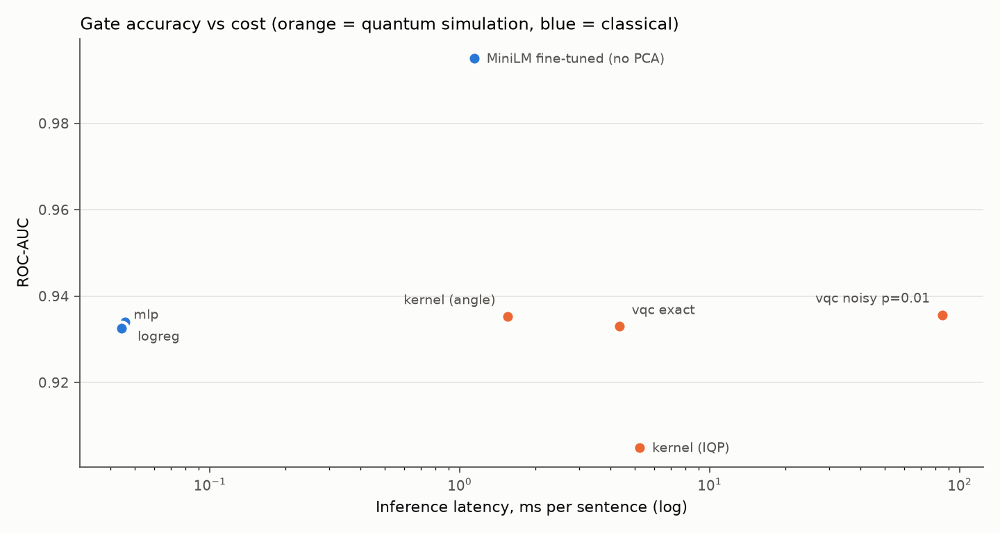

# Clean F1 hides leaks: stress-testing small-language-model PII maskers, with a quantum-vs-classical benchmark for the PII gate

_Generated from `/Users/ebricks/Desktop/pii-guardrail-qml/results` by `scripts/make_report.py`; every number below is read from a results file._

## Key results

- Gate: VQC (exact) ROC-AUC 0.933 vs logistic regression 0.934 (difference -0.001); VQC trains in 21.0 s vs 0.002 s.
- Gate: fine-tuned MiniLM without the PCA bottleneck reaches ROC-AUC 0.995, against 0.935 for the 8-feature logistic regression (both trained on the full training pool).
- Barren plateau: mean gradient variance falls 66x from 2 to 8 qubits.
- DeBERTa-v3-small: clean entity F1 0.917, character leak 0.011; worst stress-set F1 is 0.695 on `obf_all` (leak 0.051).
- Qwen2.5-0.5B + LoRA: clean entity F1 0.845, character leak 0.115; worst stress-set F1 is 0.770 on `cross_it` (leak 0.134).

## Stage 1: PII gate (quantum vs classical)

All 8-feature models see identical inputs: MiniLM-L6-v2 embeddings reduced by PCA to 8 dimensions, which keeps **27.4%** of the embedding variance. Mean ± std over seeds; evaluation on the shared balanced test subset (`n2000`/`full` = training-set size; `n500` = kernel train cap). Latency and training time are simulator wall-clock numbers, not hardware numbers.

| model | setting | size | n_seeds | AUC | PR_AUC | recall@95%prec | train s | latency ms/sent | params |
|---|---|---|---|---|---|---|---|---|---|
| logreg | classical | full | 5 | 0.935 ± 0.000 | 0.917 ± 0.000 | 0.29 ± 0.00 | 0.0207 | 0.0458 | 9 |
| logreg | classical | n2000 | 5 | 0.934 ± 0.001 | 0.916 ± 0.001 | 0.27 ± 0.04 | 0.00241 | 0.0459 | 9 |
| minilm_finetuned | raw_text | full | 3 | 0.995 ± 0.001 | 0.993 ± 0.001 | 1.00 ± 0.00 | 35.3 | 1.14 | 22,713,601 |
| minilm_finetuned | raw_text | n2000 | 3 | 0.984 ± 0.002 | 0.979 ± 0.002 | 0.94 ± 0.02 | 1.54 | 1.13 | 22,713,601 |
| mlp | classical | full | 5 | 0.944 ± 0.002 | 0.923 ± 0.004 | 0.34 ± 0.07 | 2.36 | 0.044 | 71 |
| mlp | classical | n2000 | 5 | 0.933 ± 0.004 | 0.916 ± 0.003 | 0.31 ± 0.05 | 0.253 | 0.0442 | 71 |
| qkernel_angle | exact | n500 | 3 | 0.935 ± 0.001 | 0.919 ± 0.009 | 0.21 ± 0.18 | 0.0591 | 1.55 | 0 |
| qkernel_angle | shots1024 | n500 | 3 | 0.933 ± 0.001 | 0.919 ± 0.004 | 0.21 ± 0.13 | 0.0767 | 2.39 | 0 |
| qkernel_iqp | exact | n500 | 3 | 0.905 ± 0.003 | 0.894 ± 0.004 | 0.28 ± 0.01 | 0.342 | 5.25 | 0 |
| qkernel_iqp | shots1024 | n500 | 3 | 0.901 ± 0.005 | 0.887 ± 0.005 | 0.25 ± 0.02 | 0.39 | 5.31 | 0 |
| vqc | exact | n2000 | 5 | 0.933 ± 0.002 | 0.916 ± 0.004 | 0.28 ± 0.06 | 21 | 4.34 | 74 |
| vqc | noisy_p0.001 | n2000 | 5 | 0.936 ± 0.002 | 0.915 ± 0.007 | 0.29 ± 0.14 | 21 | 84.7 | 74 |
| vqc | noisy_p0.01 | n2000 | 5 | 0.936 ± 0.002 | 0.914 ± 0.008 | 0.25 ± 0.10 | 21 | 85 | 74 |
| vqc | shots1024 | n2000 | 5 | 0.931 ± 0.004 | 0.913 ± 0.006 | 0.22 ± 0.07 | 21 | 4.24 | 74 |


The 8-feature models span ROC-AUC 0.901–0.944; the fine-tuned MiniLM is the only model outside that range.

### Barren-plateau check

Variance of ∂⟨Z₀⟩/∂θ over random initialisations (3 layers):

| n_qubits | n_layers | n_samples | var_first_param | var_mean_all_params |
|---|---|---|---|---|
| 2.0 | 3.0 | 200.0 | 8.96e-02 | 7.74e-02 |
| 4.0 | 3.0 | 200.0 | 2.00e-02 | 2.36e-02 |
| 6.0 | 3.0 | 200.0 | 2.91e-03 | 3.84e-03 |
| 8.0 | 3.0 | 200.0 | 1.25e-03 | 1.17e-03 |




## Stage 2: PII maskers

Entity F1 is strict (exact span and label). **Character leak rate** is the share of gold PII characters not covered by any predicted mask, whatever its type. Values are seed-averaged with 95% bootstrap CIs over documents (seeds share the resample). `n_seeds` is the number of training seeds behind each row.

### Entity F1

| set | DeBERTa-v3-small | Qwen2.5-0.5B + LoRA | Qwen2.5-0.5B zero-shot | SmolLM2-360M + LoRA |
|---|---|---|---|---|
| clean | 0.917 [0.907, 0.927] | 0.845 [0.824, 0.865] | 0.008 [0.003, 0.016] | 0.793 [0.772, 0.815] |
| obf_email | 0.711 [0.681, 0.741] | 0.839 [0.801, 0.876] | 0.000 [0.000, 0.000] | 0.747 [0.702, 0.788] |
| obf_phone | 0.868 [0.848, 0.889] | 0.868 [0.830, 0.905] | 0.015 [0.002, 0.032] | 0.821 [0.783, 0.857] |
| obf_name | 0.774 [0.750, 0.798] | 0.782 [0.745, 0.816] | 0.009 [0.001, 0.022] | 0.748 [0.710, 0.783] |
| obf_id | 0.806 [0.780, 0.829] | 0.805 [0.775, 0.834] | 0.010 [0.002, 0.021] | 0.780 [0.749, 0.809] |
| obf_all | 0.695 [0.674, 0.716] | 0.777 [0.753, 0.801] | 0.009 [0.002, 0.017] | 0.734 [0.708, 0.759] |
| rare | 0.878 [0.856, 0.900] | 0.802 [0.765, 0.838] | 0.015 [0.000, 0.034] | 0.765 [0.728, 0.803] |
| cross_de | 0.777 [0.762, 0.792] | 0.774 [0.751, 0.795] | 0.009 [0.004, 0.016] | 0.651 [0.628, 0.675] |
| cross_fr | 0.769 [0.754, 0.782] | 0.814 [0.792, 0.833] | 0.009 [0.004, 0.016] | 0.729 [0.706, 0.751] |
| cross_it | 0.734 [0.720, 0.748] | 0.770 [0.748, 0.790] | 0.013 [0.008, 0.020] | 0.628 [0.603, 0.652] |
| context_only | 0.000 [0.000, 0.000] | 0.000 [0.000, 0.000] | 0.000 [0.000, 0.000] | 0.000 [0.000, 0.000] |

### Character leak rate

| set | DeBERTa-v3-small | Qwen2.5-0.5B + LoRA | Qwen2.5-0.5B zero-shot | SmolLM2-360M + LoRA |
|---|---|---|---|---|
| clean | 0.011 [0.008, 0.014] | 0.115 [0.088, 0.145] | 0.597 [0.575, 0.623] | 0.130 [0.099, 0.159] |
| obf_email | 0.092 [0.072, 0.113] | 0.125 [0.076, 0.178] | 0.586 [0.537, 0.634] | 0.287 [0.234, 0.343] |
| obf_phone | 0.047 [0.033, 0.064] | 0.145 [0.092, 0.200] | 0.637 [0.584, 0.691] | 0.185 [0.138, 0.241] |
| obf_name | 0.013 [0.008, 0.018] | 0.136 [0.087, 0.186] | 0.642 [0.603, 0.680] | 0.168 [0.110, 0.222] |
| obf_id | 0.009 [0.006, 0.013] | 0.118 [0.081, 0.159] | 0.588 [0.555, 0.621] | 0.142 [0.103, 0.184] |
| obf_all | 0.051 [0.042, 0.061] | 0.146 [0.115, 0.177] | 0.619 [0.591, 0.646] | 0.217 [0.184, 0.250] |
| rare | 0.031 [0.016, 0.048] | 0.208 [0.160, 0.256] | 0.718 [0.679, 0.756] | 0.181 [0.133, 0.230] |
| cross_de | 0.022 [0.018, 0.026] | 0.129 [0.100, 0.161] | 0.622 [0.595, 0.647] | 0.186 [0.155, 0.221] |
| cross_fr | 0.015 [0.011, 0.018] | 0.093 [0.069, 0.120] | 0.634 [0.612, 0.657] | 0.130 [0.103, 0.159] |
| cross_it | 0.023 [0.019, 0.028] | 0.134 [0.105, 0.168] | 0.625 [0.602, 0.651] | 0.189 [0.154, 0.226] |
| context_only | 0.929 [0.907, 0.947] | 0.886 [0.855, 0.917] | 0.697 [0.636, 0.759] | 0.943 [0.919, 0.964] |

Seeds per model: DeBERTa-v3-small = 3, Qwen2.5-0.5B + LoRA = 1, Qwen2.5-0.5B zero-shot = 1, SmolLM2-360M + LoRA = 1.


### Change relative to the clean test set

Different documents, so the bootstrap is unpaired.

| model | set | metric | diff vs clean [95% CI] | p |
|---|---|---|---|---|
| DeBERTa-v3-small | context_only | entity_f1 | -0.917 [-0.927, -0.907] | 0.000999 |
| DeBERTa-v3-small | context_only | char_leak_rate | +0.918 [+0.896, +0.936] | 0.000999 |
| DeBERTa-v3-small | cross_de | entity_f1 | -0.141 [-0.159, -0.122] | 0.000999 |
| DeBERTa-v3-small | cross_de | char_leak_rate | +0.010 [+0.005, +0.016] | 0.000999 |
| DeBERTa-v3-small | cross_fr | entity_f1 | -0.149 [-0.167, -0.130] | 0.000999 |
| DeBERTa-v3-small | cross_fr | char_leak_rate | +0.004 [-0.001, +0.009] | 0.158 |
| DeBERTa-v3-small | cross_it | entity_f1 | -0.183 [-0.202, -0.165] | 0.000999 |
| DeBERTa-v3-small | cross_it | char_leak_rate | +0.012 [+0.007, +0.018] | 0.000999 |
| DeBERTa-v3-small | obf_all | entity_f1 | -0.222 [-0.246, -0.199] | 0.000999 |
| DeBERTa-v3-small | obf_all | char_leak_rate | +0.040 [+0.030, +0.050] | 0.000999 |
| DeBERTa-v3-small | obf_email | entity_f1 | -0.206 [-0.239, -0.175] | 0.000999 |
| DeBERTa-v3-small | obf_email | char_leak_rate | +0.081 [+0.061, +0.103] | 0.000999 |
| DeBERTa-v3-small | obf_id | entity_f1 | -0.112 [-0.139, -0.086] | 0.000999 |
| DeBERTa-v3-small | obf_id | char_leak_rate | -0.002 [-0.007, +0.003] | 0.358 |
| DeBERTa-v3-small | obf_name | entity_f1 | -0.143 [-0.170, -0.117] | 0.000999 |
| DeBERTa-v3-small | obf_name | char_leak_rate | +0.002 [-0.004, +0.007] | 0.624 |
| DeBERTa-v3-small | obf_phone | entity_f1 | -0.050 [-0.074, -0.028] | 0.000999 |
| DeBERTa-v3-small | obf_phone | char_leak_rate | +0.035 [+0.021, +0.052] | 0.000999 |
| DeBERTa-v3-small | rare | entity_f1 | -0.039 [-0.063, -0.015] | 0.000999 |
| DeBERTa-v3-small | rare | char_leak_rate | +0.020 [+0.004, +0.038] | 0.01 |
| Qwen2.5-0.5B + LoRA | context_only | entity_f1 | -0.845 [-0.865, -0.824] | 0.000999 |
| Qwen2.5-0.5B + LoRA | context_only | char_leak_rate | +0.771 [+0.728, +0.812] | 0.000999 |
| Qwen2.5-0.5B + LoRA | cross_de | entity_f1 | -0.071 [-0.101, -0.041] | 0.000999 |
| Qwen2.5-0.5B + LoRA | cross_de | char_leak_rate | +0.014 [-0.026, +0.057] | 0.514 |
| Qwen2.5-0.5B + LoRA | cross_fr | entity_f1 | -0.031 [-0.060, -0.002] | 0.042 |
| Qwen2.5-0.5B + LoRA | cross_fr | char_leak_rate | -0.022 [-0.060, +0.014] | 0.272 |
| Qwen2.5-0.5B + LoRA | cross_it | entity_f1 | -0.074 [-0.102, -0.046] | 0.000999 |
| Qwen2.5-0.5B + LoRA | cross_it | char_leak_rate | +0.018 [-0.022, +0.061] | 0.4 |
| Qwen2.5-0.5B + LoRA | obf_all | entity_f1 | -0.068 [-0.100, -0.037] | 0.000999 |
| Qwen2.5-0.5B + LoRA | obf_all | char_leak_rate | +0.031 [-0.012, +0.074] | 0.202 |
| Qwen2.5-0.5B + LoRA | obf_email | entity_f1 | -0.005 [-0.050, +0.039] | 0.874 |
| Qwen2.5-0.5B + LoRA | obf_email | char_leak_rate | +0.009 [-0.048, +0.070] | 0.836 |
| Qwen2.5-0.5B + LoRA | obf_id | entity_f1 | -0.039 [-0.074, -0.005] | 0.018 |
| Qwen2.5-0.5B + LoRA | obf_id | char_leak_rate | +0.003 [-0.044, +0.052] | 0.926 |
| Qwen2.5-0.5B + LoRA | obf_name | entity_f1 | -0.063 [-0.101, -0.025] | 0.000999 |
| Qwen2.5-0.5B + LoRA | obf_name | char_leak_rate | +0.021 [-0.037, +0.078] | 0.522 |
| Qwen2.5-0.5B + LoRA | obf_phone | entity_f1 | +0.024 [-0.019, +0.068] | 0.286 |
| Qwen2.5-0.5B + LoRA | obf_phone | char_leak_rate | +0.030 [-0.027, +0.088] | 0.368 |
| Qwen2.5-0.5B + LoRA | rare | entity_f1 | -0.043 [-0.086, -0.001] | 0.05 |
| Qwen2.5-0.5B + LoRA | rare | char_leak_rate | +0.093 [+0.037, +0.148] | 0.002 |
| SmolLM2-360M + LoRA | context_only | entity_f1 | -0.793 [-0.815, -0.771] | 0.000999 |
| SmolLM2-360M + LoRA | context_only | char_leak_rate | +0.812 [+0.773, +0.852] | 0.000999 |
| SmolLM2-360M + LoRA | cross_de | entity_f1 | -0.143 [-0.173, -0.110] | 0.000999 |
| SmolLM2-360M + LoRA | cross_de | char_leak_rate | +0.056 [+0.012, +0.101] | 0.01 |
| SmolLM2-360M + LoRA | cross_fr | entity_f1 | -0.064 [-0.093, -0.032] | 0.000999 |
| SmolLM2-360M + LoRA | cross_fr | char_leak_rate | -0.000 [-0.040, +0.039] | 0.978 |
| SmolLM2-360M + LoRA | cross_it | entity_f1 | -0.165 [-0.199, -0.130] | 0.000999 |
| SmolLM2-360M + LoRA | cross_it | char_leak_rate | +0.059 [+0.014, +0.106] | 0.012 |
| SmolLM2-360M + LoRA | obf_all | entity_f1 | -0.059 [-0.097, -0.024] | 0.000999 |
| SmolLM2-360M + LoRA | obf_all | char_leak_rate | +0.087 [+0.041, +0.133] | 0.000999 |
| SmolLM2-360M + LoRA | obf_email | entity_f1 | -0.046 [-0.096, -0.001] | 0.046 |
| SmolLM2-360M + LoRA | obf_email | char_leak_rate | +0.156 [+0.094, +0.220] | 0.000999 |
| SmolLM2-360M + LoRA | obf_id | entity_f1 | -0.013 [-0.051, +0.022] | 0.45 |
| SmolLM2-360M + LoRA | obf_id | char_leak_rate | +0.012 [-0.035, +0.063] | 0.632 |
| SmolLM2-360M + LoRA | obf_name | entity_f1 | -0.045 [-0.085, -0.003] | 0.028 |
| SmolLM2-360M + LoRA | obf_name | char_leak_rate | +0.038 [-0.023, +0.098] | 0.274 |
| SmolLM2-360M + LoRA | obf_phone | entity_f1 | +0.028 [-0.017, +0.069] | 0.198 |
| SmolLM2-360M + LoRA | obf_phone | char_leak_rate | +0.055 [-0.001, +0.118] | 0.054 |
| SmolLM2-360M + LoRA | rare | entity_f1 | -0.028 [-0.072, +0.014] | 0.172 |
| SmolLM2-360M + LoRA | rare | char_leak_rate | +0.051 [-0.003, +0.113] | 0.064 |

### Paired comparisons between maskers

Same documents; two-sided paired bootstrap; `p_holm` is Holm-adjusted within each metric.

| model_a | model_b | set | metric | a − b [95% CI] | p | p_holm |
|---|---|---|---|---|---|---|
| deberta | qwen_lora | clean | entity_f1 | +0.072 [+0.054, +0.091] | 0.000999 | 0.044 |
| deberta | qwen_lora | clean | char_leak_rate | -0.104 [-0.135, -0.076] | 0.000999 | 0.044 |
| deberta | qwen_lora | context_only | entity_f1 | +0.000 [+0.000, +0.000] | 1 | 1 |
| deberta | qwen_lora | context_only | char_leak_rate | +0.037 [+0.011, +0.066] | 0.006 | 0.048 |
| deberta | qwen_lora | cross_de | entity_f1 | -0.007 [-0.028, +0.019] | 0.656 | 1 |
| deberta | qwen_lora | cross_de | char_leak_rate | -0.105 [-0.139, -0.076] | 0.000999 | 0.044 |
| deberta | qwen_lora | cross_fr | entity_f1 | -0.043 [-0.062, -0.025] | 0.000999 | 0.044 |
| deberta | qwen_lora | cross_fr | char_leak_rate | -0.078 [-0.104, -0.054] | 0.000999 | 0.044 |
| deberta | qwen_lora | cross_it | entity_f1 | -0.035 [-0.054, -0.013] | 0.000999 | 0.044 |
| deberta | qwen_lora | cross_it | char_leak_rate | -0.109 [-0.141, -0.080] | 0.000999 | 0.044 |
| deberta | qwen_lora | obf_all | entity_f1 | -0.070 [-0.092, -0.048] | 0.000999 | 0.044 |
| deberta | qwen_lora | obf_all | char_leak_rate | -0.086 [-0.119, -0.055] | 0.000999 | 0.044 |
| deberta | qwen_lora | obf_email | entity_f1 | -0.133 [-0.176, -0.089] | 0.000999 | 0.044 |
| deberta | qwen_lora | obf_email | char_leak_rate | -0.021 [-0.075, +0.032] | 0.41 | 0.72 |
| deberta | qwen_lora | obf_id | entity_f1 | +0.016 [-0.006, +0.039] | 0.152 | 1 |
| deberta | qwen_lora | obf_id | char_leak_rate | -0.109 [-0.151, -0.070] | 0.000999 | 0.044 |
| deberta | qwen_lora | obf_name | entity_f1 | -0.006 [-0.036, +0.029] | 0.662 | 1 |
| deberta | qwen_lora | obf_name | char_leak_rate | -0.122 [-0.175, -0.074] | 0.000999 | 0.044 |
| deberta | qwen_lora | obf_phone | entity_f1 | +0.010 [-0.026, +0.050] | 0.634 | 1 |
| deberta | qwen_lora | obf_phone | char_leak_rate | -0.086 [-0.150, -0.030] | 0.002 | 0.044 |
| deberta | qwen_lora | rare | entity_f1 | +0.078 [+0.037, +0.119] | 0.002 | 0.044 |
| deberta | qwen_lora | rare | char_leak_rate | -0.175 [-0.223, -0.126] | 0.000999 | 0.044 |
| deberta | smollm_lora | clean | entity_f1 | +0.123 [+0.104, +0.144] | 0.000999 | 0.044 |
| deberta | smollm_lora | clean | char_leak_rate | -0.119 [-0.149, -0.090] | 0.000999 | 0.044 |
| deberta | smollm_lora | context_only | entity_f1 | +0.000 [+0.000, +0.000] | 1 | 1 |
| deberta | smollm_lora | context_only | char_leak_rate | -0.019 [-0.037, -0.001] | 0.046 | 0.276 |
| deberta | smollm_lora | cross_de | entity_f1 | +0.117 [+0.094, +0.139] | 0.000999 | 0.044 |
| deberta | smollm_lora | cross_de | char_leak_rate | -0.162 [-0.195, -0.131] | 0.000999 | 0.044 |
| deberta | smollm_lora | cross_fr | entity_f1 | +0.042 [+0.022, +0.060] | 0.000999 | 0.044 |
| deberta | smollm_lora | cross_fr | char_leak_rate | -0.115 [-0.143, -0.087] | 0.000999 | 0.044 |
| deberta | smollm_lora | cross_it | entity_f1 | +0.108 [+0.085, +0.130] | 0.000999 | 0.044 |
| deberta | smollm_lora | cross_it | char_leak_rate | -0.164 [-0.198, -0.130] | 0.000999 | 0.044 |
| deberta | smollm_lora | obf_all | entity_f1 | -0.027 [-0.053, -0.002] | 0.028 | 0.336 |
| deberta | smollm_lora | obf_all | char_leak_rate | -0.156 [-0.190, -0.123] | 0.000999 | 0.044 |
| deberta | smollm_lora | obf_email | entity_f1 | -0.041 [-0.083, +0.005] | 0.084 | 0.84 |
| deberta | smollm_lora | obf_email | char_leak_rate | -0.183 [-0.236, -0.130] | 0.000999 | 0.044 |
| deberta | smollm_lora | obf_id | entity_f1 | +0.041 [+0.015, +0.068] | 0.002 | 0.044 |
| deberta | smollm_lora | obf_id | char_leak_rate | -0.133 [-0.175, -0.092] | 0.000999 | 0.044 |
| deberta | smollm_lora | obf_name | entity_f1 | +0.028 [-0.010, +0.066] | 0.124 | 1 |
| deberta | smollm_lora | obf_name | char_leak_rate | -0.153 [-0.213, -0.101] | 0.000999 | 0.044 |
| deberta | smollm_lora | obf_phone | entity_f1 | +0.057 [+0.022, +0.094] | 0.002 | 0.044 |
| deberta | smollm_lora | obf_phone | char_leak_rate | -0.126 [-0.183, -0.071] | 0.000999 | 0.044 |
| deberta | smollm_lora | rare | entity_f1 | +0.115 [+0.075, +0.154] | 0.000999 | 0.044 |
| deberta | smollm_lora | rare | char_leak_rate | -0.148 [-0.196, -0.102] | 0.000999 | 0.044 |
| qwen_lora | smollm_lora | clean | entity_f1 | +0.052 [+0.037, +0.068] | 0.000999 | 0.044 |
| qwen_lora | smollm_lora | clean | char_leak_rate | -0.015 [-0.035, +0.004] | 0.112 | 0.448 |
| qwen_lora | smollm_lora | context_only | entity_f1 | +0.000 [+0.000, +0.000] | 1 | 1 |
| qwen_lora | smollm_lora | context_only | char_leak_rate | -0.056 [-0.088, -0.027] | 0.000999 | 0.044 |
| qwen_lora | smollm_lora | cross_de | entity_f1 | +0.123 [+0.101, +0.143] | 0.000999 | 0.044 |
| qwen_lora | smollm_lora | cross_de | char_leak_rate | -0.058 [-0.083, -0.032] | 0.000999 | 0.044 |
| qwen_lora | smollm_lora | cross_fr | entity_f1 | +0.084 [+0.069, +0.099] | 0.000999 | 0.044 |
| qwen_lora | smollm_lora | cross_fr | char_leak_rate | -0.037 [-0.054, -0.021] | 0.000999 | 0.044 |
| qwen_lora | smollm_lora | cross_it | entity_f1 | +0.142 [+0.122, +0.161] | 0.000999 | 0.044 |
| qwen_lora | smollm_lora | cross_it | char_leak_rate | -0.055 [-0.075, -0.035] | 0.000999 | 0.044 |
| qwen_lora | smollm_lora | obf_all | entity_f1 | +0.043 [+0.025, +0.063] | 0.000999 | 0.044 |
| qwen_lora | smollm_lora | obf_all | char_leak_rate | -0.071 [-0.096, -0.046] | 0.000999 | 0.044 |
| qwen_lora | smollm_lora | obf_email | entity_f1 | +0.092 [+0.065, +0.120] | 0.000999 | 0.044 |
| qwen_lora | smollm_lora | obf_email | char_leak_rate | -0.162 [-0.217, -0.107] | 0.000999 | 0.044 |
| qwen_lora | smollm_lora | obf_id | entity_f1 | +0.025 [+0.008, +0.043] | 0.004 | 0.056 |
| qwen_lora | smollm_lora | obf_id | char_leak_rate | -0.024 [-0.050, -0.001] | 0.038 | 0.266 |
| qwen_lora | smollm_lora | obf_name | entity_f1 | +0.034 [+0.007, +0.063] | 0.008 | 0.104 |
| qwen_lora | smollm_lora | obf_name | char_leak_rate | -0.032 [-0.067, +0.002] | 0.07 | 0.35 |
| qwen_lora | smollm_lora | obf_phone | entity_f1 | +0.047 [+0.015, +0.078] | 0.000999 | 0.044 |
| qwen_lora | smollm_lora | obf_phone | char_leak_rate | -0.040 [-0.099, +0.026] | 0.24 | 0.72 |
| qwen_lora | smollm_lora | rare | entity_f1 | +0.037 [+0.002, +0.070] | 0.036 | 0.396 |
| qwen_lora | smollm_lora | rare | char_leak_rate | +0.027 [-0.025, +0.080] | 0.352 | 0.72 |
| qwen_lora | qwen_zeroshot | clean | entity_f1 | +0.836 [+0.815, +0.856] | 0.000999 | 0.044 |
| qwen_lora | qwen_zeroshot | clean | char_leak_rate | -0.482 [-0.511, -0.450] | 0.000999 | 0.044 |
| qwen_lora | qwen_zeroshot | context_only | entity_f1 | +0.000 [+0.000, +0.000] | 1 | 1 |
| qwen_lora | qwen_zeroshot | context_only | char_leak_rate | +0.189 [+0.120, +0.260] | 0.000999 | 0.044 |
| qwen_lora | qwen_zeroshot | cross_de | entity_f1 | +0.765 [+0.741, +0.786] | 0.000999 | 0.044 |
| qwen_lora | qwen_zeroshot | cross_de | char_leak_rate | -0.493 [-0.528, -0.455] | 0.000999 | 0.044 |
| qwen_lora | qwen_zeroshot | cross_fr | entity_f1 | +0.804 [+0.783, +0.825] | 0.000999 | 0.044 |
| qwen_lora | qwen_zeroshot | cross_fr | char_leak_rate | -0.541 [-0.570, -0.510] | 0.000999 | 0.044 |
| qwen_lora | qwen_zeroshot | cross_it | entity_f1 | +0.757 [+0.736, +0.776] | 0.000999 | 0.044 |
| qwen_lora | qwen_zeroshot | cross_it | char_leak_rate | -0.492 [-0.526, -0.455] | 0.000999 | 0.044 |
| qwen_lora | qwen_zeroshot | obf_all | entity_f1 | +0.768 [+0.744, +0.793] | 0.000999 | 0.044 |
| qwen_lora | qwen_zeroshot | obf_all | char_leak_rate | -0.473 [-0.508, -0.435] | 0.000999 | 0.044 |
| qwen_lora | qwen_zeroshot | obf_email | entity_f1 | +0.839 [+0.802, +0.876] | 0.000999 | 0.044 |
| qwen_lora | qwen_zeroshot | obf_email | char_leak_rate | -0.462 [-0.511, -0.405] | 0.000999 | 0.044 |
| qwen_lora | qwen_zeroshot | obf_id | entity_f1 | +0.795 [+0.767, +0.826] | 0.000999 | 0.044 |
| qwen_lora | qwen_zeroshot | obf_id | char_leak_rate | -0.470 [-0.518, -0.425] | 0.000999 | 0.044 |
| qwen_lora | qwen_zeroshot | obf_name | entity_f1 | +0.773 [+0.735, +0.806] | 0.000999 | 0.044 |
| qwen_lora | qwen_zeroshot | obf_name | char_leak_rate | -0.506 [-0.559, -0.446] | 0.000999 | 0.044 |
| qwen_lora | qwen_zeroshot | obf_phone | entity_f1 | +0.853 [+0.810, +0.893] | 0.000999 | 0.044 |
| qwen_lora | qwen_zeroshot | obf_phone | char_leak_rate | -0.491 [-0.561, -0.419] | 0.000999 | 0.044 |
| qwen_lora | qwen_zeroshot | rare | entity_f1 | +0.787 [+0.747, +0.825] | 0.000999 | 0.044 |
| qwen_lora | qwen_zeroshot | rare | char_leak_rate | -0.510 [-0.568, -0.455] | 0.000999 | 0.044 |

### Cost

Latency is one document at a time; throughput is batched over all evaluation sets.

| model | seeds | train s | trainable params | latency p50 ms | latency p95 ms | docs/s | peak MB |
|---|---|---|---|---|---|---|---|
| DeBERTa-v3-small | 3 | 64 | 141,348,153 | 3.5 | 18.0 | 528.6 | 589 |
| Qwen2.5-0.5B + LoRA | 1 | 310 | 8,798,208 | 396.9 | 893.4 | 18.0 | 1,960 |
| Qwen2.5-0.5B zero-shot | 1 | 0 | 0 | 491.7 | 851.9 | 19.5 | 984 |
| SmolLM2-360M + LoRA | 1 | 321 | 8,683,520 | 637.0 | 1297.1 | 13.1 | 741 |

## Two-stage pipeline

_Pipeline results not found in `results/pipeline/`._

## Limitations and what is not claimed

- **Simulator only.** All quantum numbers come from classical simulation (`default.qubit`, plus a
  depolarizing-noise model). No real quantum hardware was used, so noise results are model
  predictions, not hardware measurements, and simulator latency says nothing about hardware latency.
- **Feature bottleneck.** The 8 gate features are a PCA projection of MiniLM embeddings; models that
  see only these features share that ceiling. Comparisons between them say little about the models
  on richer features.
- **Product-state kernel.** The angle-embedding fidelity kernel equals a closed-form product kernel
  (tested in `tests/test_gate.py`), so it is classically trivial by construction.
- **Dataset.** `ai4privacy/pii-masking-300k` is synthetic and templated, and some source spans are
  corrupted; documents with corrupted spans were excluded (counts in the data card). Results may not
  transfer to real-world text.
- **LLM masking.** LLMs return PII *text*; spans are recovered by exact string match, which masks
  every occurrence of a returned string and misses altered strings. Invalid JSON counts as no
  detections.
- **Context-only set.** The 50 synthetic examples use a label unseen in training, so strict F1 is 0
  by construction; the leak rate is the meaningful number. They were written by the project author
  and have not been independently reviewed.
- **Obfuscation sets** are rule-based transformations and cover only a few evasion styles.
- **Seeds and CIs.** Intervals capture document-sampling noise (and seed averaging where several seeds
  exist); they do not capture variation across datasets.

## Reproduce

```
make setup
make PROFILE=full data stress gate masker eval pipeline report   # needs a CUDA GPU
make smoke                                                       # quick check of every stage
```

Run records (config, seed, git commit, timings, metrics) are in `results/`; this report is
generated from them by `scripts/make_report.py`.
