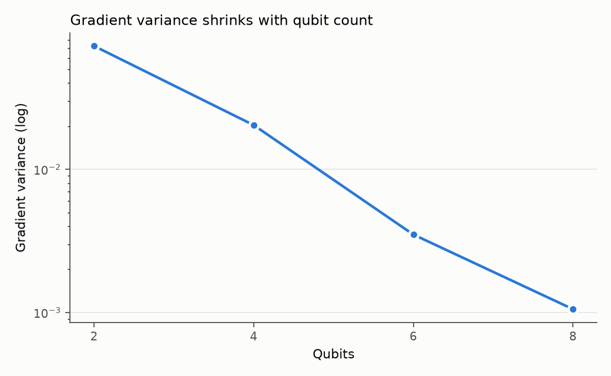
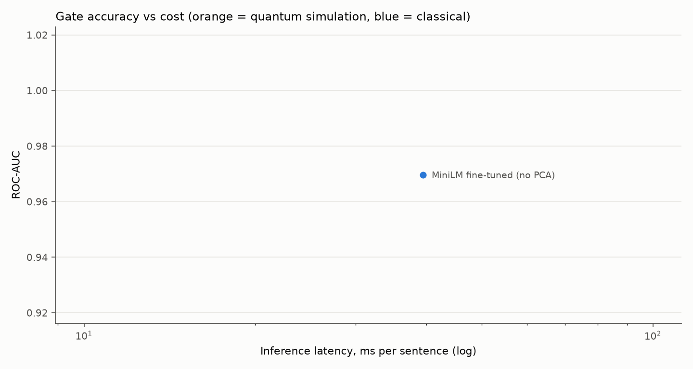
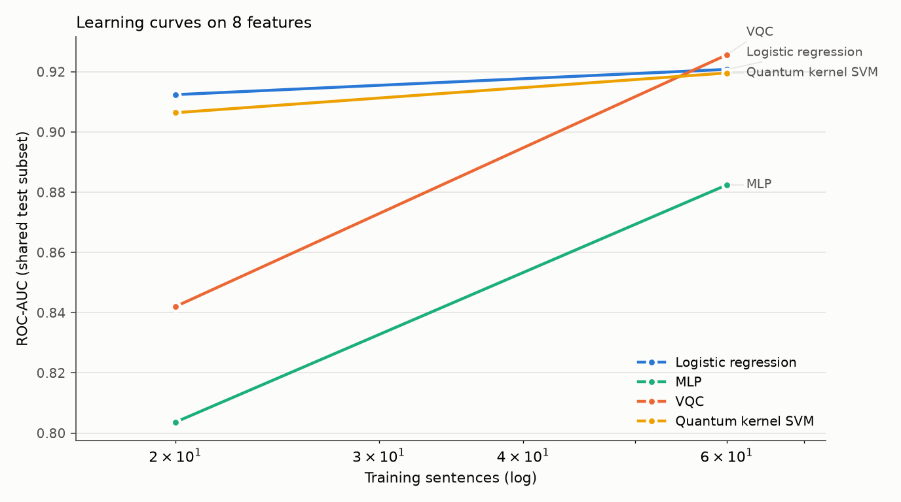
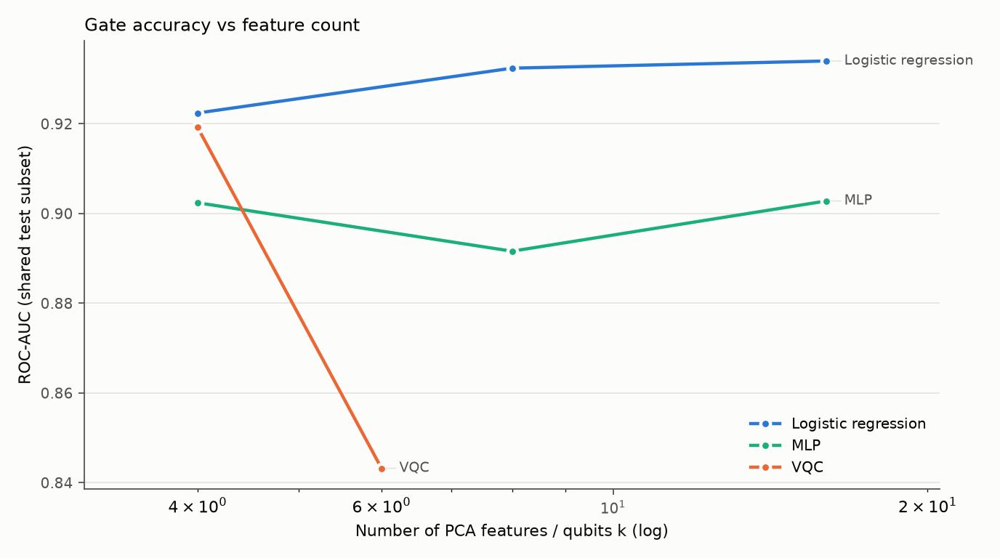

# Clean F1 hides leaks: stress-testing small-language-model PII maskers, with a quantum-vs-classical benchmark for the PII gate

_Generated from `results/smoke` by `scripts/make_report.py`; every number below is read from a results file._

## Key results

- Gate: fine-tuned MiniLM without the PCA bottleneck reaches ROC-AUC 0.970, against 0.942 for the 8-feature logistic regression (both trained on the full training pool).
- Barren plateau: mean gradient variance falls 69x from 2 to 8 qubits.
- Low data (n=20): Logistic regression 0.912, MLP 0.804, Quantum kernel SVM 0.906, VQC 0.842 ROC-AUC.
- VQC ablation: best variant `reupload_L3` with ROC-AUC 0.853.
- Feature sweep: logistic regression goes from ROC-AUC 0.922 at k=4 to 0.934 at k=16.

## Stage 1: PII gate (quantum vs classical)

All 8-feature models see identical inputs: MiniLM-L6-v2 embeddings reduced by PCA to 8 dimensions, which keeps **27.3%** of the embedding variance. Mean ± std over seeds; evaluation on the shared balanced test subset (`n2000`/`full` = training-set size; `n500` = kernel train cap). Latency and training time are simulator wall-clock numbers, not hardware numbers.

| model | setting | size | n_seeds | AUC | PR_AUC | recall@95%prec | train s | latency ms/sent | params |
|---|---|---|---|---|---|---|---|---|---|
| logreg | classical | full | 2 | 0.942 ± 0.000 | 0.925 ± 0.000 | 0.76 ± 0.00 | 0.0112 | 0.207 | 9 |
| logreg | classical | n200 | 2 | 0.939 ± 0.003 | 0.923 ± 0.003 | 0.60 ± 0.06 | 0.00979 | 0.209 | 9 |
| minilm_finetuned | raw_text | full | 1 | 0.970 ± 0.000 | 0.948 ± 0.000 | 0.90 ± 0.00 | 39.6 | 39.4 | 22,713,601 |
| minilm_finetuned | raw_text | n200 | 1 | 0.838 ± 0.000 | 0.823 ± 0.000 | 0.08 ± 0.00 | 11.2 | 98.2 | 22,713,601 |
| mlp | classical | full | 2 | 0.938 ± 0.002 | 0.924 ± 0.000 | 0.66 ± 0.08 | 1.2 | 0.17 | 71 |
| mlp | classical | n200 | 2 | 0.892 ± 0.041 | 0.879 ± 0.037 | 0.34 ± 0.14 | 0.144 | 0.183 | 71 |
| qkernel_angle | exact | n100 | 1 | 0.896 ± 0.000 | 0.882 ± 0.000 | 0.38 ± 0.00 | 0.0477 | 2.77 | 0 |
| qkernel_angle | shots1024 | n100 | 1 | 0.938 ± 0.000 | 0.934 ± 0.000 | 0.44 ± 0.00 | 0.0531 | 2.79 | 0 |
| qkernel_iqp | exact | n100 | 1 | 0.757 ± 0.000 | 0.736 ± 0.000 | 0.10 ± 0.00 | 0.207 | 17.4 | 0 |
| qkernel_iqp | shots1024 | n100 | 1 | 0.730 ± 0.000 | 0.717 ± 0.000 | 0.12 ± 0.00 | 0.208 | 17.6 | 0 |
| vqc | exact | n200 | 2 | 0.910 ± 0.008 | 0.882 ± 0.002 | 0.09 ± 0.07 | 1.61 | 18 | 74 |
| vqc | noisy_p0.001 | n200 | 2 | 0.993 ± 0.009 | 0.994 ± 0.008 | 0.97 ± 0.05 | 1.61 | 258 | 74 |
| vqc | noisy_p0.01 | n200 | 2 | 0.993 ± 0.009 | 0.994 ± 0.008 | 0.97 ± 0.05 | 1.61 | 228 | 74 |
| vqc | shots1024 | n200 | 2 | 0.912 ± 0.012 | 0.889 ± 0.001 | 0.12 ± 0.08 | 1.61 | 16.4 | 74 |

### Barren-plateau check

Variance of ∂⟨Z₀⟩/∂θ over random initialisations (3 layers):

| n_qubits | n_layers | n_samples | var_first_param | var_mean_all_params |
|---|---|---|---|---|
| 2.0 | 3.0 | 20.0 | 6.32e-02 | 7.26e-02 |
| 4.0 | 3.0 | 20.0 | 1.13e-02 | 2.03e-02 |
| 6.0 | 3.0 | 20.0 | 2.67e-03 | 3.50e-03 |
| 8.0 | 3.0 | 20.0 | 1.19e-03 | 1.05e-03 |







## Additional quantum scenarios (exact simulation)

Mean ± std over seeds on the shared balanced test subset; bands in the figures are ±1 std.

### Low-data regime

| train sentences | logreg | mlp | qkernel_angle | vqc |
|---|---|---|---|---|
| 20 | 0.912 ± 0.000 | 0.804 ± 0.000 | 0.906 ± 0.000 | 0.842 ± 0.000 |
| 60 | 0.921 ± 0.000 | 0.882 ± 0.000 | 0.920 ± 0.000 | 0.926 ± 0.000 |



### VQC ablation: depth and data re-uploading

| variant | n_seeds | ROC-AUC | recall@95%prec | train s | params |
|---|---|---|---|---|---|
| layers1 | 1 | 0.603 ± 0.000 | 0.04 | 0.8 | 26 |
| layers2 | 1 | 0.810 ± 0.000 | 0.00 | 1.1 | 50 |
| reupload_L3 | 1 | 0.853 ± 0.000 | 0.20 | 1.7 | 74 |

### Feature-count sweep

The VQC uses k qubits for k features; classical models can use more features. `PCA variance kept` is the share of embedding variance retained.

| features k | PCA variance kept | logreg | mlp | vqc |
|---|---|---|---|---|
| 4 | 18.7% | 0.922 | 0.902 | 0.919 |
| 6 | 24.4% | – | – | 0.843 |
| 8 | 28.8% | 0.932 | 0.892 | – |
| 16 | 41.9% | 0.934 | 0.903 | – |



## Stage 2: maskers

_Run `make eval` first (`results/eval/masker_ci.csv` missing)._

## Two-stage pipeline

_Pipeline results not found in `results/pipeline/`._

## Limitations and what is not claimed

- **Simulator only.** All quantum numbers come from classical simulation (`default.qubit`, plus a
  depolarizing-noise model). No real quantum hardware was used, so noise results are model
  predictions, not hardware measurements, and simulator latency says nothing about hardware latency.
- **Feature bottleneck.** The 8 gate features are a PCA projection of MiniLM embeddings; models that
  see only these features share that ceiling. Comparisons between them say little about the models
  on richer features.
- **Product-state kernel.** The angle-embedding fidelity kernel equals a closed-form product kernel
  (tested in `tests/test_gate.py`), so it is classically trivial by construction.
- **Dataset.** `ai4privacy/pii-masking-300k` is synthetic and templated, and some source spans are
  corrupted; documents with corrupted spans were excluded (counts in the data card). Results may not
  transfer to real-world text.
- **LLM masking.** LLMs return PII *text*; spans are recovered by exact string match, which masks
  every occurrence of a returned string and misses altered strings. Invalid JSON counts as no
  detections.
- **Context-only set.** The 50 synthetic examples use a label unseen in training, so strict F1 is 0
  by construction; the leak rate is the meaningful number. They were written by the project author
  and have not been independently reviewed.
- **Obfuscation sets** are rule-based transformations and cover only a few evasion styles.
- **Seeds and CIs.** Intervals capture document-sampling noise (and seed averaging where several seeds
  exist); they do not capture variation across datasets.

## Reproduce

```
make setup
make PROFILE=full data stress gate masker eval pipeline report   # needs a CUDA GPU
make smoke                                                       # quick check of every stage
```

Run records (config, seed, git commit, timings, metrics) are in `results/`; this report is
generated from them by `scripts/make_report.py`.
